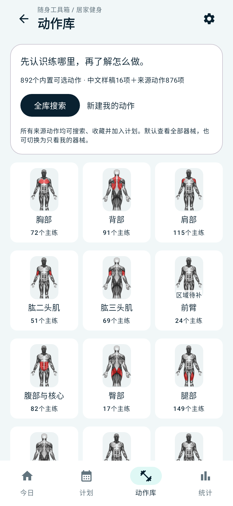
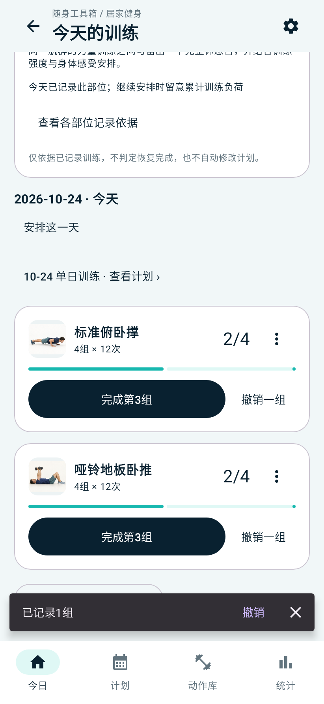
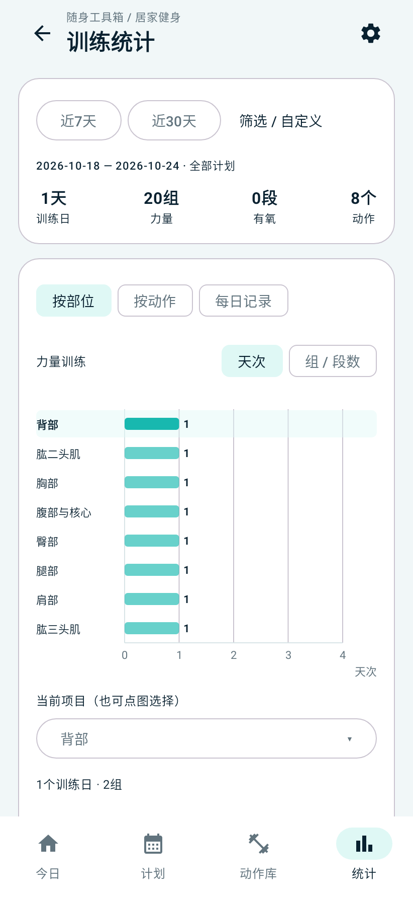

<p align="center"></p>
<h1 align="center">Pocket Toolbox · 随身工具箱</h1>
<p align="center"><a href="README.md">简体中文</a> · <strong>English</strong></p>
<p align="center">An offline native Android toolkit for everyday use</p>

<p align="center">
  <a href="https://github.com/Shaco-C/multi-tools/releases/latest"></a>
  
  
  
</p>

Pocket Toolbox combines **electricity bill splitting, dietary discomfort tracking, and home workout tracking** in one app. Each tool stores its data locally and provides its own backup and restore workflow. Three light themes are available. The app interface is currently in Simplified Chinese; this README provides English project documentation.

## Download and install

The current stable release is **v1.2.0**, introducing home workout tracking.

- [Download the release APK](https://github.com/Shaco-C/multi-tools/releases/download/v1.2.0/multi-tools-v1.2.0.apk)
- [Download the SHA-256 checksum](https://github.com/Shaco-C/multi-tools/releases/download/v1.2.0/multi-tools-v1.2.0.apk.sha256)
- [Release notes](https://github.com/Shaco-C/multi-tools/releases/tag/v1.2.0) · [All releases](https://github.com/Shaco-C/multi-tools/releases)

Requires Android 8.0 or later. The release retains the `com.pockettoolbox` application ID and existing release signing certificate. Version code 3 supports upgrading v1.0.0 / v1.1.0 while retaining app data. Export each tool's backup before upgrading.

Debug builds use `com.pockettoolbox.debug` and the launcher label “随身工具箱·测试版”. They can be installed alongside the release app and have independent storage. To move workout data from the test app to the release, export a fitness ZIP from the test app and restore it in the release.

## Home workouts

- **Planning:** single-day and multi-day plans, muscle groups, exercises, set targets, repetitions or seconds, rest days, templates, and saved drafts.
- **Flexible recording:** every exercise has its own completion button. Alternate between exercises in any order, undo sets, inspect records, enter actual values, and backfill past dates.
- **One coordinate chart:** compare muscle groups or exercises using labeled bars with a shared axis. Switch between days and sets/segments, filter dates and plans, and select a bar to inspect its records. Lists longer than 12 entries use pages with the same scale.
- **Full exercise library:** 892 selectable entries comprising 876 source exercises and 16 Chinese drafts, with categories, search, favorites, and direct addition to plans.
- **Offline reference material:** 1,746 source photos plus draft illustrations and muscle diagrams. Source exercises retain their original English names and instructions. Units and total/per-side measurement can be changed before the first recorded set.
- **Backups with images:** fitness ZIPs include plans, completed and revoked records, personal exercises and images, favorites, templates, equipment preferences, and saved drafts.

892 is an entry count; some Chinese drafts may correspond to source exercises. No entries have completed professional review. Chinese teaching content and muscle illustrations remain incomplete, and the app displays the relevant content status.

<p align="center">
  
  
  
</p>

Screenshots show actual Android Compose pages rendered in host tests with sample data. Further design and validation details are available in the [fitness documentation](docs/居家健身工具/README.md), in Chinese.

## Electricity and dietary discomfort

| Tool | Features |
| --- | --- |
| Electricity | Allocate costs by consumption, distribute fractional-cent remainders, manage bills, reuse previous meter readings, and view labeled personal cost trends. |
| Dietary discomfort | Record meals associated with discomfort; manage brands, foods, and symptom types; store meal dates and automatic symptom timestamps; link multiple episodes to one meal; inspect history and labeled brand charts; filter and correct records. |

Dietary statistics describe personally recorded associations. They do not establish causes or incidence rates. See the [implementation guide](docs/饮食不适工具实施记录-20261002.md), in Chinese.

## Backups and device migration

Each tool exports and restores its own backup:

| Tool | Location in the app | Restore format |
| --- | --- | --- |
| Electricity | History → Export and restore | JSON: bills, readings, allocations, and timestamps |
| Dietary discomfort | Manage → Export and restore | JSON: brands, foods, symptom types, meals, episodes, and settings |
| Fitness | Manage → Fitness backup | ZIP: workout data, personal images, and saved drafts |

1. Export the required backups from the old phone or test app and transfer them to the destination.
2. Choose the backup in its corresponding tool, review the validation summary, and confirm. Restoring replaces that tool's current data, so export existing data first.
3. Check the restored data before clearing the old phone or uninstalling the old app.

CSV exports from electricity and dietary discomfort are for spreadsheets and cannot be restored. Backup files are not encrypted. Android automatic backup is disabled; export manually before uninstalling.

## Development

Stack: Kotlin, Jetpack Compose / Material 3, Navigation Compose, and Room; JDK 17, Gradle 9.6.0, AGP 9.4.0; `compileSdk 37`, `targetSdk 36`, `minSdk 26`.

Modules: `app → feature:electricity / feature:diet / feature:fitness → core:*`. Each tool uses a separate database.

On Windows, use a project path without non-ASCII characters. This machine uses the junction `D:\Program\multi-tools\android_app`. SDKs, Gradle caches, and temporary directories can be placed on D:. See the [Android setup guide](docs/本机Android开发准备-20260913.md), in Chinese.

```powershell
# From the repository root, download/verify the pinned source photo ZIP excluded from Git.
.\content\fitness\scripts\restore-source-archive.ps1
cd android_app
.\gradlew.bat :core:common:test :feature:electricity:testDebugUnitTest :feature:diet:testDebugUnitTest :feature:fitness:testDebugUnitTest :app:assembleDebug
```

| Build | Launcher label | Application ID | Version name |
| --- | --- | --- | --- |
| Debug | 随身工具箱·测试版 | `com.pockettoolbox.debug` | `1.2.0-debug` |
| Release | 随身工具箱 | `com.pockettoolbox` | `1.2.0` |

For signed release builds, create `android_app/keystore.properties` using the adjacent `.example` file. Signing keys, passwords, device databases, backups, and build outputs are excluded from Git.

```powershell
.\gradlew.bat :app:lintRelease :app:assembleRelease
```

[release.properties](content/fitness/android/release.properties) controls fitness release availability and pins the shipped content. Professional review status is stored independently. Builds extract offline images from the locally verified source ZIP; the app does not download media at runtime.

## Validation and attribution

Host tests cover domain rules, Room storage, backup and restore, ViewModels, and page interactions. Release checks also verify signing, application IDs, and offline image hashes in the final APK. System file pickers, touch, keyboard behavior, and performance still require physical-device acceptance. See the [v1.2.0 release notes](docs/release-notes-v1.2.0.md) and [release validation record](docs/居家健身工具/21-v1.2.0正式发布.md), with Chinese documentation.

The app manifest does not request Internet access. Android source is in `android_app/`, documentation in `docs/`, and the web prototype in `prototype/`.

Source exercise records and photos come from [yuhonas/free-exercise-db](https://github.com/yuhonas/free-exercise-db), pinned to a fixed revision under the Unlicense. Attribution and license files are included in the APK. See the [source ledger](content/fitness/sources/README.md) and [draft media attribution](content/fitness/pilot/README.md).
