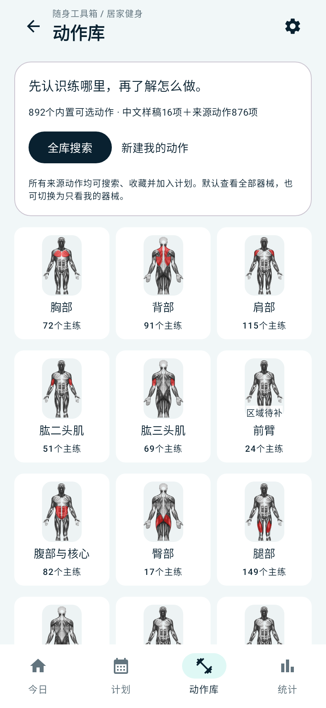
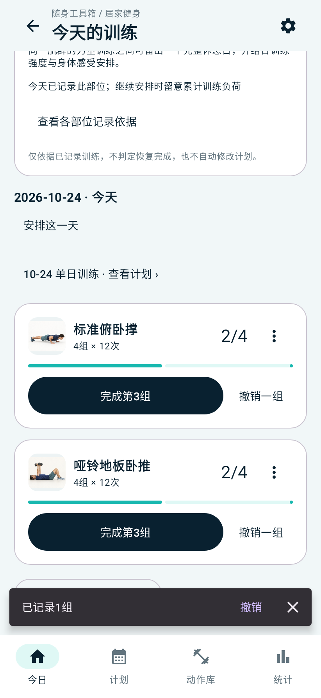
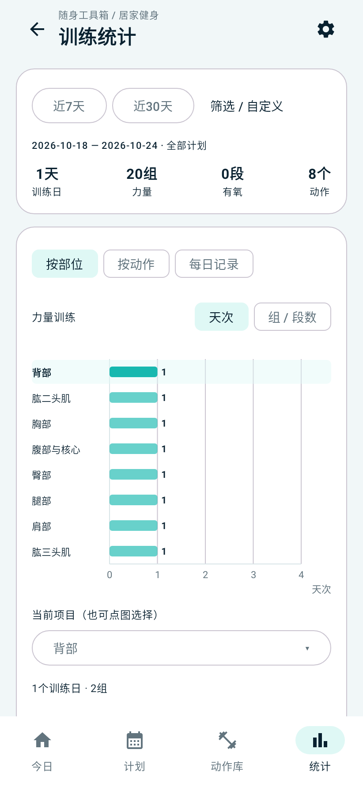

<p align="center">
  
</p>

<h1 align="center">随身工具箱</h1>

<p align="center"><strong>简体中文</strong> · <a href="README.en.md">English</a></p>

<p align="center">离线优先、轻量可靠的原生 Android 日常工具集合</p>

<p align="center">
  <a href="https://github.com/Shaco-C/multi-tools/releases/latest"></a>
  
  
  
</p>

“随身工具箱”把电费分摊、饮食不适记录与居家健身集中在一个应用中：精确分摊电费，回顾出现过不适的品牌和食品，安排训练并记录每一组。各工具的数据、历史与备份分别保存在本机。

**v1.2.0 正式加入居家健身工具**：训练计划、任意动作顺序的逐组记录与撤销、历史补记、统一坐标图统计、个人动作和带图片的 ZIP 备份。动作库可选 892 个内置条目（876 个来源动作＋16 个中文样稿），支持分类、搜索、收藏及直接加入计划；来源动作保留英文原名、原说明与1,746张离线原图。892是条目数，部分中文样稿与来源动作可能对应；中文教学和专业审校尚未完成，审校数量仍为0，应用内保留说明。设计细节见 [统计、全量动作与自由记组](docs/居家健身工具/20-统计图与全量动作及自由记组.md)，本次发布见 [v1.2.0验证记录](docs/居家健身工具/21-v1.2.0正式发布.md)。

<p align="center">
  
  
  
</p>

截图为主机运行实际Android Compose页面生成的固定示例数据。

## 下载

前往 [GitHub Releases](https://github.com/Shaco-C/multi-tools/releases/latest) 下载最新正式版 APK。应用最低支持 Android 8.0（API 26）。

当前正式版 **v1.2.0**，新增居家健身。可直接 [下载正式版 APK](https://github.com/Shaco-C/multi-tools/releases/download/v1.2.0/multi-tools-v1.2.0.apk)、[SHA-256校验文件](https://github.com/Shaco-C/multi-tools/releases/download/v1.2.0/multi-tools-v1.2.0.apk.sha256)，或查看 [本版更新说明](https://github.com/Shaco-C/multi-tools/releases/tag/v1.2.0)。沿用既有正式签名，versionCode升至3，可覆盖升级v1.0.0 / v1.1.0并保留本机数据；更新前建议分别导出各工具备份。

## 已有功能

- **精确电费分摊**：按实际用量计算，处理分币余数，确保各户金额之和等于总账单。
- **历史账单管理**：保存、查看、修改和删除每月账单。
- **自动带入**：创建新账单时带入上一期电表结构和读数。
- **本人费用趋势**：展示折线、每个节点的金额、平均费用和最高费用。
- **本地导入导出**：支持 JSON 备份恢复和适合表格软件查看的 CSV 导出。
- **背景主题**：内置清爽、暖白、纯白三种高对比度浅色主题，并记住选择。
- **饮食不适记录**：只登记出现不适的饮食，进食日期记到日；点击记录自动保存不适日期和时分，同一顿饮食可以关联多次不适。
- **常用选项管理**：统一维护品牌、品牌下的食品和不适类型，默认“腹泻”；支持改名、停用和重新启用，保留历史关联。
- **饮食明细与统计**：查看品牌及食品历史、带数字的品牌横向柱状图，切换“不适次数 / 关联饮食次数”，按类型和近 30 / 90 天筛选。
- **记录修正**：支持修改、删除与撤销，以及结束 / 恢复一顿饮食记录。饮食数据支持独立 JSON 备份恢复与 CSV 导出。
- **训练计划**：单日与多日安排、主练部位、动作目标、休息日、模板和草稿暂存。
- **自由计组**：每个动作独立记录，可A、B、A交替完成，支持撤销、组明细、实际值与历史补记。首次记组前可调整次数/秒数、合计/每侧口径。
- **健身统计**：同一张带数字的柱状坐标图比较部位或动作，支持天次/组段数、日期及计划筛选，超过12项分页且保持统一量程，可点选查看组成记录。
- **健身资料**：全量动作库分类、搜索、收藏、离线原图、个人动作及带图片的ZIP备份恢复。
- **离线与隐私**：Manifest 不声明联网权限，业务数据仅保存在当前设备。

## 技术架构

- Kotlin + Jetpack Compose + Material 3
- 单 Activity、Navigation Compose
- Room 本地数据库
- 多模块结构：`app → feature:electricity / feature:diet / feature:fitness → core:*`
- JDK 17、Gradle 9.6.0、AGP 9.4.0
- `compileSdk 37`、`targetSdk 36`、`minSdk 26`

## 换手机与备份

三个工具分别导出和恢复自己的数据：

| 工具 | 备份入口 | 恢复文件与内容 |
| --- | --- | --- |
| 电费分摊 | 历史记录 → 数据导出与恢复 | JSON：全部月份账单、每户读数、分摊金额与时间 |
| 饮食不适记录 | 管理 → 数据导出与恢复 | JSON：品牌、食品、不适类型、饮食、每次不适的时间、记录状态与默认设置 |
| 居家健身 | 管理 → 健身资料备份 | ZIP：计划、完成/撤销历史、个人动作及图片、收藏、模板、器械偏好和已暂存草稿 |

1. 在旧手机或测试版中分别导出各工具的备份，将JSON / 健身ZIP转移到目标手机或正式版。
2. 在目标应用的对应工具备份页选择文件。应用会先校验并显示预检结果，确认后恢复。
3. 恢复采用**替换当前工具全部数据**的方式，不进行合并；其他工具不受影响。新手机已有记录时，请先备份。
4. 检查新手机记录完整后，再处理旧手机上的数据。

电费、饮食的CSV仅用于表格软件查看，不能恢复。网页原型中的示例数据独立保存，不属于Android备份。JSON / CSV / ZIP均未加密，请妥善保管。

## 本地开发

Windows 环境建议从不含中文的入口路径打开工程，例如本机使用的 `D:\Program\multi-tools\android_app`。

测试版和正式版使用不同包名，可以在同一部手机上同时安装：

| 构建 | 手机显示名称 | 包名 | 版本名称 |
| --- | --- | --- | --- |
| Debug | 随身工具箱·测试版 | `com.pockettoolbox.debug` | `1.2.0-debug` |
| Release | 随身工具箱 | `com.pockettoolbox` | `1.2.0` |

两者的数据库、个人图片和主题设置各自独立；安装或卸载测试版不会覆盖正式版的数据。测试版首次安装为空数据，需要已有记录时，可在正式版导出对应工具的备份，再到测试版手动导入。后续Debug包沿用同一测试包名与本机Debug签名，可覆盖升级测试版并保留测试数据。

```powershell
# 在仓库根目录补齐被 Git 忽略的健身源图包（已存在且校验通过时不下载）
.\content\fitness\scripts\restore-source-archive.ps1
cd android_app
.\gradlew.bat :core:common:test :feature:electricity:testDebugUnitTest :feature:diet:testDebugUnitTest :feature:fitness:testDebugUnitTest :app:assembleDebug
```

健身使用独立 `fitness.db`；换机备份入口为“健身 → 管理 → 导出健身 ZIP”。恢复会先预检，再替换本机健身资料。测试版与正式版数据库各自独立；若要迁移测试训练记录，请手动导出ZIP并在正式版恢复。

正式发布的健身开关和锁定内容版本见 [release.properties](content/fitness/android/release.properties)，专业审校状态独立保存。构建时从已校验的本地ZIP提取图片，运行时离线使用。

正式包需要创建 `android_app/keystore.properties`。可复制 `keystore.properties.example` 后填写自己的密钥路径和密码；真实密钥与配置已由 `.gitignore` 排除。

```powershell
.\gradlew.bat :app:lintRelease :app:assembleRelease
```

本机迁移、SDK 路径和设备验收步骤见 [Android 开发准备](docs/本机Android开发准备-20260913.md)。采用的总体方案见 [原生安卓应用设计方案](docs/方案A-原生安卓应用设计方案.md)。

## 项目目录

- `android_app/`：正式 Android 工程。
- `prototype/`：早期交互原型，用于设计对照。
- `docs/`：架构、迁移、交付和版本说明。

## 数据与安全

账单、饮食与训练分别保存在独立的Room数据库中。应用不声明联网权限，系统自动备份和迁移已关闭；换机或卸载前，请分别导出JSON / 健身ZIP。仓库不提交签名密钥、设备数据库、个人导出数据、SDK路径或构建产物。

## 验证与素材来源

主机测试覆盖领域规则、Room事务、备份恢复、ViewModel及页面交互；发布时核对签名、包名及APK中的离线图片哈希。系统文件选择器、触摸、键盘和流畅度仍需真机验收。结果见 [v1.2.0发布说明](docs/release-notes-v1.2.0.md)。

来源动作与原图来自 [yuhonas/free-exercise-db](https://github.com/yuhonas/free-exercise-db)，使用固定版本与Unlicense；出处和授权文件随APK分发。版本、哈希与来源见 [素材来源台账](content/fitness/sources/README.md)，中文样稿和肌肉图见 [样稿素材说明](content/fitness/pilot/README.md)。

饮食统计只描述已记录的餐后不适关联，不计算发生率、不判断原因，也不会将未记录的食品标记为安全。使用与验收步骤见 [饮食不适工具实施记录](docs/饮食不适工具实施记录-20261002.md)。
