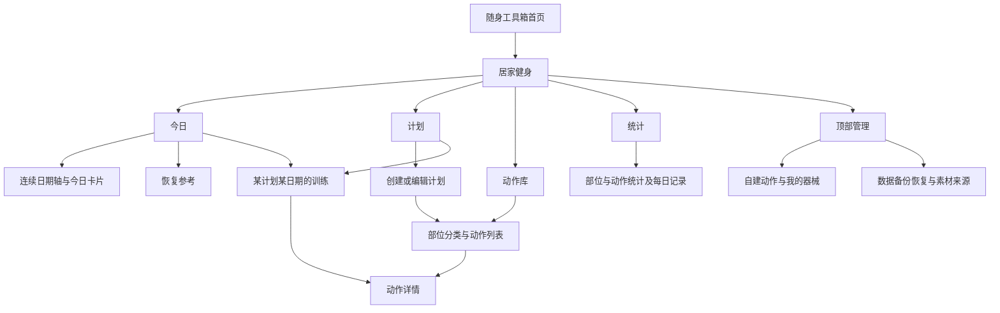

# 居家健身工具 · 产品需求与交互设计

版本：产品评审稿 v0.2 / 2026-10-22。器械定位已由用户确认；其余标为“建议”的规则可在评审中调整。首页、统计及恢复提示的完整规则见 [06](06-首页时间轴统计与恢复建议.md)。

## 1. 产品价值与三种视角

**用户视角**：我下班后只想照着今天的安排训练。做完一组后不用回忆，能马上知道“做了 2 组，还剩 2 组”；忘记姿势时能看教学，回来继续记组。

**产品经理视角**：把“选什么动作、哪天做、做到哪里”连成闭环。动作库的信息可以丰富，训练中的主操作应始终简单。图片、名称、目标和进度同屏可见。

**甲方验收视角**：常用动作确实齐备，图与动作对应，说明能看懂；计划能按日期执行；组数可靠保存；误触可撤销；更新内容和编辑计划不会破坏历史。发布数量以有效、可用、已审校的动作计数。

核心成功标准：用户完成一组后，正常情况下只需点击一次就能保存记录；再次进入时无需重新数数。

## 2. 典型完整场景

以下日期与“4 组 × 20 次”来自用户示例，仅用于说明软件行为，不是系统给出的训练剂量建议。

1. 创建“下班居家训练”，日期范围选 2026-10-22 至 2026-10-23，包含首尾两天。
2. 10 月 22 日选择胸、肩；10 月 23 日选择腹部核心、腿部。
3. 10 月 23 日添加仰卧起坐和徒手深蹲，分别填写 4 组、每组 20 次。保存前可查看两天汇总。
4. 10 月 23 日进入计划，直接看到当天两张动作卡片，各为 `0/4 组`。
5. 做完一组深蹲，点击“完成第 1 组”，保存成功后显示 `1/4 组`，按钮改为“完成第 2 组”。
6. 点击动作图查看教学，返回后仍停留在同一天、同一位置，进度不变。
7. 不确定刚才是否误触，可以查看最近完成时间，并撤销上一组。
8. 关闭应用再打开，仍显示已保存进度。两项都记录 4 组后显示“今日计划已完成”。

## 3. 信息架构



- “今日”：连续日期时间轴、连续训练与今日部位卡、恢复参考、可继续的训练、按日期回看记录。
- “计划”：创建、查看、编辑、复制、归档计划。
- “动作库”：部位入口、搜索、筛选、动作详情；展示全部内置内容与自建动作。
- “统计”：近 7 天、近 30 天、自定义日期；部位训练天次、动作天次、完成组数、可选填写的次数/时长。
- “管理”：右上角入口，包含器械偏好、自建动作、备份恢复、内容来源说明。
- 底部固定四项“今日 / 计划 / 动作库 / 统计”；管理不再占底部页签。
- 首页工具卡只负责进入本工具。以上导航均属于健身模块，不扩大工具箱全局导航。

## 4. 首个完整版本与后续范围

| 范围 | 首个完整版本 | 后续版本 |
| --- | --- | --- |
| 动作库 | 常用动作、部位肌肉图、列表双图、中文详情、步骤图、器械筛选、搜索 | 扩充动作、增加经过审核的动图 |
| 自建动作 | 名称、部位、器械、计量、说明、自选图片；修改与停用 | 更丰富的个人视频管理 |
| 手动计划 | 日期范围、每日部位与动作、组数与次数/秒数、排序、复制一天安排 | 周期模板、复杂轮转计划 |
| 训练记录 | 一击完成一组、撤销、进度、持久化、按日期回看；组明细可选补实际次数/时长 | 重量、主观强度、不同组目标、快捷额外加组 |
| 首页日程 | 连续日期轴、部位标签、休息/未安排、连续训练与今日部位卡 | 更丰富的月历和计划执行趋势 |
| 统计 | 7/30天、自定义、部位与动作训练天次、组数、已填次数/时长及覆盖率 | 训练容量、长期趋势、导出报告 |
| 恢复参考 | 最近记录、一般间隔建议、连续日同肌群安排提示 | 有更多输入后再设计强度/主观状态辅助 |
| 辅助训练 | 查看教学并返回、最近记录时间 | 休息倒计时、通知提醒、可选常亮 |
| 自动挑选 | 暂不纳入首版 | 依据部位、器械、数量和难度挑选，可预览替换 |
| 数据 | 离线、工具独立备份恢复、保留历史 | 跨设备同步另行立项 |

素材小样和开发验证可以先使用少量动作，但对外交付应达到评审后的内容覆盖要求。不能只完成计组页面，就把“大量内置动作”默认为后续事项。

## 5. 动作库：先知道练哪里，再知道怎么做

### 5.1 部位入口

首屏建议提供十个主要部位：胸部、背部、肩部、肱二头肌、肱三头肌、前臂、腹部与核心、臀部、腿部、小腿。全身、有氧、热身与活动作为补充入口，避免把所有动作硬塞入单块肌肉分类。

每张分类卡包含：部位肌肉高亮图、中文名称、可用动作数。背部、三头、臀部等优先显示背面视图；可在分类说明中切换正背面。分类图使用统一人体底图，外观保持一致。

用户说的“肌肉透视图”在产品中定义为**人体肌肉分布与目标部位高亮示意图**。图上同时写部位名称及图例；主要参与和辅助参与使用不同视觉标记，不宣称颜色表示精确发力百分比。

### 5.2 搜索与筛选

- 搜索支持中文名、常见别名和英文名。例如“飞鸟”能搜到胸部哑铃飞鸟和肩后束反向飞鸟，但用完整名称区分。
- 筛选维度：部位、器械、入门/进阶标签、内置/自建。
- “我的器械”默认按用户已确认范围设置为徒手、哑铃、弹力带；辅助固定点、训练凳、单杠等单独勾选。
- 默认优先呈现器械匹配的居家动作，保留“查看全部”入口。没有合适动作时说明缺什么器械或给出已有可用替代动作。
- “居家可用”必须满足一项动作的完整器械条件，不能因为带有“哑铃”标签就忽略其必需的训练凳。

### 5.3 动作列表中的双图

普通浏览模式每行左侧并列放两张小图：肌肉图、姿势图；右侧是名称、器械和主要部位。图片下方或无障碍说明明确两张图的含义。

```text
胸部                         搜索
器械：我的器械 ▾      全部 / 入门

┌─────────────────────────────┐
│ [肌肉图] [姿势图]  标准俯卧撑 │
│                    徒手       │
│                    胸部  查看 ›│
├─────────────────────────────┤
│ [肌肉图] [姿势图]  哑铃地板卧推│
│                    哑铃＋地面 │
└─────────────────────────────┘
```

在手机常规字号下可采用约 60–64dp 的双缩略图；小屏或大字体时改成双图在上、文字在下的卡片，保留两张图和完整动作名。最终尺寸由原型与真机检查确定。

在计划选动作模式中，新增独立的勾选控件和底部“已选 N 个 · 下一步”。点图片/名称仍查看详情，点勾选才改变选择，避免用户想看教学却误选。选中状态、筛选和滚动位置在查看详情后保留。

### 5.4 动作详情的信息顺序

1. 动作名称、常见别名、器械条件、计量方式。
2. 教学动图或分步图片；提供暂停、逐张查看与放大。
3. 一句话说明“这个动作是什么”。
4. 肌肉分布图：主要部位、辅助部位、正背面和文字标签。
5. 准备姿势 → 运动过程 → 结束/还原；每步配图、编号和简短动作提示。
6. 常见错误与关键提醒，控制在容易边练边看的长度。
7. 可用的简化动作或替代动作，只有内容审核通过才展示。
8. 来源与内容版本，折叠在末尾。

来自计划创建页时底部为“加入所选日期”；来自训练页时为“返回训练”。从动作库直接加入计划时先选择计划和具体日期，不能默默加入今天。

动图不自动计组、不需要联网播放。没有动图时明确显示“步骤图 1/N”；两张静态图切换不包装成连续标准动作演示。静态保持类动作显示进入、保持要点和退出，而非捏造重复运动过程。

## 6. 创建计划：日期明确，日程可以复用

### 6.1 第一步：名称与日期范围

填写计划名称，选择开始日和结束日。日期包含首尾，可只选一天。名称可先根据范围生成，如“10.22—10.23 居家训练”，用户可修改。

创建过程自动保存为本地草稿；明确点击“保存计划”后才成为可执行计划。放弃草稿有独立入口，不能混同于删除已有训练记录。

### 6.2 第二步：安排每个日期的部位

范围内每个自然日都可查看，状态分为“训练日 / 休息日 / 未安排”。用户对训练日多选部位。可以把同一部位组合批量应用到选中的日期，并在提交前预览。

“未安排”不等于“休息日”；保存时提示未安排的日期，允许保留。至少一个日期有完整动作配置，且所有标记为“训练日”的日期都已选好动作并填完目标，才保存为可执行计划。其他训练日只选了部位或仍缺组次时，提示补齐，或由用户明确改为未安排；不完整配置只保留草稿。

### 6.3 第三步：为训练日选动作和组次

- 根据所选部位和器械条件展示候选动作，多选后统一填写组数和每组目标。
- 同一动作出现在两个部位下时，该日期按动作 ID 去重。
- 多个部位按“任一部位匹配”展示候选，默认使用主要训练部位匹配；辅助参与可作为显式扩展筛选。
- 添加不在当前部位范围的力量动作时，提示补充部位或修改选择。移除部位时列出受影响的动作，不能静默删除。非力量动作按活动分类选择。
- 动作可排序；修改顺序不改变动作身份。首版同一计划日不重复添加同一个动作，复杂训练块留待后续。
- 第一次填写目标由用户决定；可以批量设置或沿用自己的上次配置，界面标明来源，不把某个默认数值包装成适合用户的训练建议。
- 支持 `4 组 × 20 次`、`3 组 × 30 秒`；单侧动作写成 `3 组 × 每侧 12 次`。同一组两侧都完成才记一组。
- 次数与秒数不互相转换。将次数目标批量应用到计时动作时，必须单独填写该动作的时长。
- 热身、拉伸和有氧通过独立活动分类添加；纯有氧计划无需选择胸腿等力量部位。非力量条目按“段”显示，混合日汇总分别列力量组数和活动段数。每个条目保存本次用途，首版同一天同动作只选一种用途，不拆成多个训练块。

### 6.4 第四步：预览并保存

```text
下班居家训练        10.22—10.23

10月22日  胸部 / 肩部
  已选动作与目标……                 编辑

10月23日  腹部核心 / 腿部
  仰卧起坐      4组 × 20次
  徒手深蹲      4组 × 20次

                  [保存计划]
```

预览展示每日动作数、目标组数、器械需求和未安排日期。支持“复制这一天到其他日期”；复制只复制安排，不复制完成记录。只允许覆盖没有训练记录的目标日，覆盖已有未开始安排前说明影响。目标日已有完成或撤销记录时，保留其安排和历史，提示选择其他日期，或按编辑规则调整未开始的动作。

## 7. 今日与计划训练页：组数永远清楚

### 7.1 默认打开哪一天

| 进入时的情况 | 默认展示 |
| --- | --- |
| 今天在计划范围内且有安排 | 今天的动作与已记录组数 |
| 今天为休息日或未安排 | 如实显示状态，同时提供下一训练日入口 |
| 计划尚未开始 | 首个训练日预览，显示“尚未开始” |
| 计划已经结束 | 范围汇总和日期回看；未完成记录仍保留 |
| 今天有多个计划 | 按计划分组显示，分别进入；计数不合并 |

日期条始终可切换。回看过去日期时仍能明确补记或撤销，并标明实际记录时间；未来日期默认仅预览，不能误把今天做的组数记到尚未到来的日程。需要提前训练时先将未开始安排移动或复制到今天。

工具首页顶部采用连续自然日时间轴：节点上方纵向展示部位标签，节点下方展示日期和星期，休息与未安排明确写出。时间轴下方为两张近似方形卡片“连续训练 X 天”“今日计划部位”，再显示简短恢复参考与所选日动作。切换历史日后，两卡仍表示今天，动作区单独标明所选日期。完整线框、多计划聚合和统计口径见 [06](06-首页时间轴统计与恢复建议.md)。

### 7.2 单个动作卡片

```text
‹ 居家健身        下班居家训练
10月23日 · 周五    腹部核心 / 腿部
已确认 3 / 8 组

┌────────────────────────────────┐
│ [姿势缩略图]  徒手深蹲        › │
│ 目标：4组 × 20次                │
│                                │
│          已完成 2 / 4 组        │
│          ●  ●  ○  ○            │
│ 最近一组：19:42                │
│                                │
│        [ 完成第 3 组 ]         │
│                撤销上一组      │
└────────────────────────────────┘
```

- 卡片图片和名称打开教学，计组按钮单独占一行。点击整张卡片不能直接加组。
- 按钮建议至少 56dp 高，较现有普通按钮放大；数字与文字足够醒目。
- 进度圆点在组数较少时辅助显示；组数多时使用数字和进度条，避免一排大量小点。
- 保存成功后更新进度并给予轻量反馈；保存过程中拦截重复提交。失败时保持原进度并允许重试。
- 成功提示带“撤销”，卡片上也长期保留“撤销上一组”，不用抢在提示消失前操作。
- 达到目标组数后显示“已完成”，停止自动增加。撤销后恢复下一组按钮。
- 首版可以在不同动作之间交替记组，无需强制按顺序完成；也不强制先按“开始训练”。

### 7.3 完成一组到底记录什么

每次点击表示用户确认该动作完成了一组。首版不要求逐组输入实际次数，因此页面只能可靠展示“已确认 2 组、目标每组 20 次”，不能据此宣称实测完成 40 次，也不计算实际训练重量或热量。

组明细提供可选“补充实际次数/时长”，不打断默认的一击记组。只有用户明确填写或确认按该组目标填写后，才进入次数/时长统计；部分填写时显示覆盖组数，左右侧分别解释。详情见 06 的指标字典。

计时类动作由用户自行完成目标时间后点击。首版没有内置计时器时要说明“完成后手动记录”，不能出现看似正在自动计时的界面。

### 7.4 中断、跨日与误触

每组立即保存。进教学、切页签、锁屏、关闭应用、进程重启都不会重置组数。返回详情前的滚动位置属于体验恢复，保存组数属于数据正确性，两者分别验收。

训练中跨过午夜，正在操作的训练日保持不变；显示日期已变化的提示并提供“切到今天”。用户可继续把这次组数记在原训练日，记录实际点击时间。重新进入工具则按今天定位，并显示昨天未完成训练的回看入口。

短时间意外连击只记一次；明确撤销或重新进入页面不会使同一保存操作重复生效。不同计划、不同日期、不同动作的组数互不影响。

## 8. 自建动作

“管理 → 我的动作 → 新建”，动作库中也提供入口。必填项为名称、用途、统计主归属、至少一个教学主要部位、器械条件和计量方式；力量动作选择一个统计主部位，其他用途使用对应活动分类。说明、别名、步骤图片可逐步完善。

用户可选本地图片，肌肉图根据部位生成统一示意；未提供教学图片时显示明确占位与“暂无教学图片”，动作仍可用于个人计划。内置动作的内容完整标准高于个人自建动作。

内置条目采用“复制为我的动作”后修改，保留原始库。被计划或历史引用的自建动作通过停用退出新动作选择；历史仍能显示名称、目标及已有媒体。图片更换或删除不能留下无法恢复的引用。

## 9. 自动挑选动作的后续方案

用户选择日期与部位，为每个部位填写动作数量，再填写目标组数和次数/秒数，系统给出可编辑草稿。

候选池依次满足：已发布内容、主要部位、完整器械条件、难度偏好、自定义排除项。然后去重、按动作类型适当分散，最后随机挑选。同一复合动作只占一个主要部位配额，其他参与部位仍显示标签。

用户可锁定某个动作、单个替换、重新生成剩余动作。候选不足时说明缺多少，不重复塞入同一动作，也不放宽器械要求而不告知。计时动作的目标需单独填写。

生成结果先预览、后保存，不能改动已有训练记录。界面称“按条件挑选动作”，不把随机组合宣称为个性化科学训练处方。

## 10. UI 与现有项目的衔接

- 保持清爽、暖白、纯白三套浅色主题；背景、表面、文字优先使用现有主题语义色。
- 延续海军蓝主卡、薄荷青主操作、圆角卡片与轻量分隔。训练中的大组数是视觉中心。
- 普通页面延续约 18dp 水平边距、920dp 最大内容宽度、20–21dp 普通卡片圆角；训练主操作根据可触达性适度放大。
- 肌肉图使用独立的固定图例，保持跨主题一致；肌群高亮与选中状态不能只依赖颜色区分。
- 动作列表不自动播放全部动图。详情页只播放当前展示的媒体，用户能暂停并逐步查看。
- 顶部返回、系统返回、弹窗关闭、创建草稿恢复和教学返回统一设计。
- 大字体时优先让名称、组数、按钮和双图完整显示，允许改为上下布局。
- 页面状态包含加载、无安排、空动作库筛选结果、素材缺失、保存失败和完成状态，均有清晰下一步。
- 日期轴节点、两列统计卡和图表沿用现有间距、圆角、字体与主题；日期状态和肌群参与不能仅靠颜色表达。统计使用可读数值和横向条形图，避免复杂仪表盘抢占记组主流程。

## 11. 甲方可以直接走通的评审脚本

1. 不创建计划，直接按“胸部”查找动作，看到分类肌肉图和列表双图。
2. 搜索“飞鸟”，能够区分胸部飞鸟和肩后束反向飞鸟，并检查所需器械。
3. 按用户示例创建两日计划，第二天含两个 4×20 动作，预览与保存内容一致。
4. 连续记录、进入教学、返回、退出应用再进入，组数准确；误触能撤销。
5. 同一天建立第二个计划，同名动作计数仍相互独立。
6. 查看平板支撑与单臂划船，分别明确“秒”和“每侧次数”的含义。
7. 自建动作附图片、加入计划、训练后停用，历史可继续查看。
8. 导出健身备份并恢复，动作、计划、记录和自建图片完整，其他工具数据不受影响。
9. 时间轴连续展示训练、休息和未安排日期；切换历史日，“今日部位”卡片不跟着改日期。
10. 用 06 的手算样例核对 7/30 天、部位与动作统计，以及跨计划去重、补记和撤销。
11. 未填实际次数时只显示组数；补填部分组后显示已填次数与覆盖率，秒数和每侧次数不混算。
12. 同肌群近期记录或相邻日计划能触发参考提示，但不能出现“已经恢复”或禁止用户继续的强制结论。
