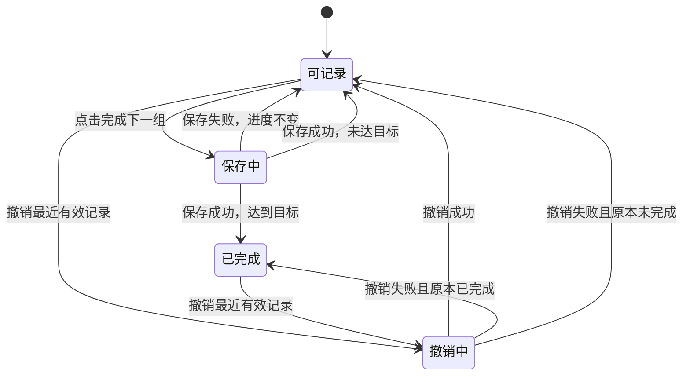

# 居家健身工具 · 数据规则与验收清单

状态：产品行为与概念模型 v0.3，2026-10-23。这里定义用户可见结果和数据边界，不是最终数据库 DDL 或实现代码。首页、统计与恢复规则的详细说明见 [06](06-首页时间轴统计与恢复建议.md)，本轮复核与后续出口见 [08](08-设计复核与下一阶段计划.md)。

## 1. 核心概念

| 概念 | 含义 |
| --- | --- |
| 动作定义 | 一个动作的身份、介绍、部位、器械、计量与教学素材 |
| 计划 | 名称、日期范围及范围内各天的安排 |
| 计划日 | 某计划的一个明确自然日，标记训练/休息/未安排 |
| 计划动作 | 某天选中的动作、用途、排序、目标组数/段数和每组/段目标 |
| 完成组记录 | 用户在某时间确认某计划动作完成了一组；有氧/热身/拉伸在界面使用“段” |
| 内容快照 | 用户当时采用的身份、名称、目标、计量、用途和统计/教学肌群，用于稳定解释历史 |
| 实际值补充 | 用户可选填写的逐组次数/秒数；与目标、完成组数分开 |
| 自建动作 | 用户自己维护的动作内容，可引用个人图片 |

关系是：`计划 → 计划日 → 计划动作 → 完成组记录`。动作定义可被多个计划动作引用，但各自的完成记录完全独立。

动作内容、计划目标和训练记录分别管理。更新动作库不能重新计算已完成组数；改动未来计划不能覆盖过去的训练。

## 2. 一组完成的准确语义

每次确认产生一条可独立识别的记录，至少关联计划、日期、计划动作，并保留记录时刻、当时的每组目标、用途和计量口径。数据量小也应守住同一计划动作同一组只能有一条有效完成记录的原则。

首版记录的是“用户确认完成了几组”，不是传感器识别的动作次数。若不录入实际次数，不能将 `完成组数 × 目标次数` 作为实际次数，更不能据此推算实际重量或热量。

单侧动作若目标为“每侧 12 次”，同一组左右各做一轮后确认一组；12 是目标，不能据确认按钮推断实际每侧恰好完成 12 次。首版不分别计左右组数。交替动作的“一次”定义由动作说明和计划显示共同明确。

实际值在组明细可选补充：正整数次数或秒数；未填写为空，不是 0。每侧口径可分别填写左右值，明确“同值填两侧”时才复制数值。支持改正或清空，不改变该组是否有效。统计保留单位、左右口径与填写覆盖率；“按目标填写”必须是用户明确操作，不在记组时自动执行。

### 保存与撤销

- 保存成功才向用户确认完成；失败显示原因和重试入口，目标与既有记录保留。
- 同一次按钮操作因重试、页面重建等再次提交时，不重复增加组数。
- 快速连点在当前保存期间只产生一次有效操作。保存完成后的短时间连击保护需要在原型阶段校准，不能用过长锁定阻碍真实训练。
- 撤销针对清楚的具体记录；同一次撤销重复提交只撤销一次，不能连带删除另一组。
- 撤销只影响当前计划、当前日期、当前动作最近的一组。可连续明确操作，逐组纠正。
- 组记录可保留撤销状态或等价审计信息；最终采用哪种存储方式在实现设计时确定。
- 达到目标后主按钮停止加组。需要更多组时，明确修改目标组数后再记录。
- 撤销后再次完成是新的确认操作，保留原撤销事实，但同一组序位同时最多一条有效记录。展示的“第N组”不是数据库身份；移除再加入、页面重建或重试不得据此新建一份进度。

## 3. 计划、日期与计量规则

| 项目 | 建议规则 |
| --- | --- |
| 日期范围 | 起止均包含，结束日不得早于开始日；展示完整年份避免歧义 |
| 保存计划 | 首次保存至少有一个训练日，且所有训练日目标完整；每个所选力量部位都有同统计主部位的动作。已有历史的计划可结束全部剩余安排并保留历史 |
| 休息/未安排 | 两种不同状态，不算未完成的动作 |
| 日期部位 | 多选；计划按单一统计主部位选动作和核对覆盖，教学辅助参与不替代计划主部位 |
| 重复动作 | 同一计划日按动作 ID 去重；不同日期或不同计划可重复 |
| 排序 | 每天独立排序，排序变化不能改变记录归属 |
| 目标组数/次数 | 正整数；上限与异常输入提示在交互验证中确定，不写成训练建议 |
| 秒数 | 正整数，显示为易读的秒或分秒；与次数分开校验 |
| 单侧目标 | 明确每侧，不自动乘二改变显示或记录口径 |
| 活动用途 | 默认取审核后的动作用途，计划条目可选择该动作允许的用途；无任何完成/撤销记录时可改，有记录后不直接切换 |
| 混合日程 | 力量按组、有氧/热身/拉伸按段显示；汇总分别显示，不混成力量组数 |
| 多计划重叠 | 允许，按计划区分；不自动合并同名动作 |
| 复制计划或一天 | 复制目标，不复制完成记录；覆盖仅限目标日无训练记录（含撤销记录），复制日期需重新确认 |
| 未来日期 | 默认预览；提前执行需将未开始安排移到或复制到今天 |
| 过去日期 | 可明确补记或撤销，保存实际操作时间与原训练日期 |

首版每个动作采用统一的每组目标。不同组使用不同次数、递减组、超级组、循环训练块等进入后续范围。

首版同一计划日同一动作只保留一个条目及一种用途，暂不支持同动作同时拆成热身块和正式块。计划可添加独立热身/拉伸/有氧条目，也可只有有氧；非力量条目按活动分类选择，不要求虚构胸、腿等力量部位。力量部位筛选只匹配力量动作。

## 4. 修改计划时保护已发生的记录

| 操作 | 未开始的日期或动作 | 已有完成组记录 |
| --- | --- | --- |
| 修改名称 | 可修改 | 记录归属稳定；历史必要名称有快照 |
| 调整动作顺序 | 可修改 | 可修改，不改变记录身份 |
| 修改组数 | 可修改 | 不得小于有效已完成组数；改后重新显示完成比例 |
| 修改次数或秒数目标 | 可修改 | 只作用于尚未完成组；已完成组保留当时目标快照 |
| 切换次数/秒数或左右计量 | 无任何记录时可修改并重新填写目标 | 已记录动作禁止直接切换，即使全已撤销；确需不同口径时在其他日期或其他计划另建安排 |
| 修改用途或统计主归属 | 无任何记录时可按内容允许的选项修改 | 当前计划动作保持原语义，完成与撤销历史不重分类；内容库改版仅影响新安排 |
| 替换动作 | 可替换 | 不把原记录迁移成另一动作；原动作转为历史保留项，新动作另建 |
| 从当天安排移除动作 | 可移除 | 明示保留已完成记录；结束剩余安排后以“已移除/停止”标记保留历史 |
| 训练日改为休息 | 可修改 | 不清除训练事实；先明确结束剩余安排，历史仍按原日期可见 |
| 缩短范围、移动日期 | 可调整未开始安排 | 不把已有记录自动搬家或隐去，需保留原日期历史 |
| 删除整个计划 | 无记录时确认删除 | 默认归档；彻底删除记录是独立操作并明确范围 |

例：已经确认 2 组、原目标每组 20 次，后来将剩余组改成每组 15 次。界面显示“当前目标每组 15 次，前 2 组按原目标记录”，组明细保留原目标。不能直接把这 2 组改成 15 次，也不能假定用户实际完成了原目标次数。

原本 `4/4` 已完成，明确把目标提高到 5 组后变成 `4/5`，这是用户修改目标产生的结果；不能在后台自动增加目标。

从计划中移除的已训练动作不参与当前剩余目标，但保留已记录组数。汇总分别显示“当前安排完成情况”和“历史已记录”，避免删除未完成动作后悄悄把过去达成率变高。

“未开始”指当前条目没有任何完成或撤销记录，不是有效组数恰好为0。移除后再次加入同一计划日的同动作，应恢复原条目ID与进度；不能用删除重加绕过计量/用途冻结，也不能把旧组迁入另一动作。

计划状态首版明确为草稿、生效、归档；“尚未开始/进行中/已结束”由生效计划的日期与当前日期推导。草稿不贡献首页安排或统计。归档停止新记组和补记，但允许回看、撤销误记及改正已填实际值；取消归档前预览恢复的安排，原日期不平移。无剩余安排时显示相应空状态和历史记录，不显示`0/0`或把空集合判为全部完成。

## 5. 日期与中断恢复

- 计划日以自然日存储，不能将其作为 UTC 午夜转换后重新归属。
- 每次完成组同时记录实际时间和当时的时区信息，便于在跨时区后解释历史。
- 在打开的训练日上跨午夜，继续固定原日期；切换今天需明确操作。
- 离开再进入“今日”按当前本地日期定位；昨天未完成不会自动迁移、清空或补齐。
- 正在保存时切换日期，结果仍属于发起时的计划动作；不得按保存结束时页面的选择重新归属。
- 读取不同日期的异步结果只更新对应页面状态，不能用较慢的旧结果覆盖新选择。
- 回看、补记、撤销可纠正历史，但不能把补记的操作时间伪装成过去的真实训练时间。
- 区分训练归属日期、记录操作时刻、可选实际训练时刻及时间来源（实时确认/用户补充/仅日期）。补记未填实际时刻时，恢复提示只按日描述；不能按补记按钮时间开始倒算恢复间隔。
- 近 7/30 天和自定义统计按训练归属日期、包含首尾计算；时区改变不搬移旧记录。跨午夜固定原训练日的记录仍统计到原日，恢复参考使用可信的实际记录时刻。

## 6. 内置内容、自建内容与更新

内置内容使用稳定 ID 与内容版本。名称改写、图片更新或分类调整不更换同一动作的身份；动作定义实质变化时另建条目或明确版本迁移。

计划动作与完成记录保留必要快照，至少包括稳定动作 ID、名称、目标、计量、所选用途、单一统计主归属、主要/辅助肌群及内容版本。首版不要求为每条记录复制所有媒体，但引用的内容必须可解释；旧媒体被移除时保留必要文字，不显示错误动作代替。

自建动作的个人图片存应用私有目录，动作停用或被历史引用时不能随意删除文件。真正清理媒体之前检查所有有效引用；无引用资源如何清理属于实施细节。

内置库修正文案后可让详情展示最新版，并提示内容更新；历史名称和当时目标仍能查看。涉及错误教学的内容应先停止向新计划推荐，再处理已有引用提示，不能无声换成不同动作。

## 7. 备份与换机

用户可在“管理 → 数据备份与恢复”导出本工具资料。范围包括计划、日期安排、完成与撤销记录、可选实际值和时刻及其来源、统计/肌群快照、自建动作、个人图片、器械与提醒偏好、所引用的内容版本。电费和饮食数据不在此备份内。

建议使用单个健身备份包，内部包含结构化数据、资源清单和用户图片；内置媒体可通过稳定 ID/版本引用，通常无需把整个动作库重复导出。实际是否采用 ZIP 包在实现前确认。

现有 `BackupContributor` 契约只处理 JSON 字符串，不能直接声称它已经支持图片备份包。实施时可以复用数据预检和恢复理念，需专门设计媒体打包、临时校验与失败回滚；不因新增健身工具顺带改写其他工具的备份格式。

恢复前显示计划数、记录数、自建动作数、图片数、版本与将替换的范围。确认后仅替换健身数据；数据和图片必须共同成功或保持原状态。缺图、损坏文件、不支持的版本需要清楚提示，不能只恢复文字后宣称完整成功。

如果目标版本没有某个内置动作，保留动作快照和历史记录，并提示教学内容不可用；不能把用户数据当作未知内容直接丢弃。内置商业媒体若不允许备份再分发，应保持为内容版本引用。

## 8. 与当前工程的边界

建议未来使用 `feature:fitness`，入口 `tools/fitness`，独立数据库 `fitness.db`。这些是设计名称，本次没有创建模块或数据库。

模块内采用现有的 presentation / domain / data 职责分层，新增工具通过 ToolModule 注册。应用壳只组装入口与依赖；动作库、计划、组记录、图片处理和导出归本工具管理。

内容加载与用户数据读取要区分：内置库可以只读资源提供；用户修改不直接写入内置文件。实际查询应先限定计划日和动作范围，再批量补充所需内容。避免每张卡片分别查询整个动作库或加载全部原图。

统计从有效记录推导；按日期范围与计划范围先筛选，再按稳定动作 ID/主归属汇总。不要把主要/辅助肌群一对多展开后重复累计组数。统计缓存若存在，补记、撤销、实际值修改、彻底删除与恢复都必须同步失效；不能在恢复后把缓存再加到记录之上。完整公式及可手算样例见 06。

这里使用 Room / SQLite，按实际数据库结构和查询检查正确性、事务及性能。工作区服务端的 PostgreSQL/Druid 兼容性要求仅在对应技术环境中适用。

## 9. 验收场景

| 编号 | 场景 | 预期结果 |
| --- | --- | --- |
| A01 | 新装后离线打开动作库 | 分类、中文说明、肌肉图、步骤图均可使用 |
| A02 | 搜索飞鸟 | 胸部飞鸟和反向飞鸟有明确完整名称与部位区分 |
| A03 | 只勾选哑铃、未勾训练凳 | 必须用凳的动作不被标成完全符合我的器械 |
| A04 | 部位页和动作详情肌肉图 | 同一肌群映射一致，主要/辅助有文字图例 |
| A05 | 动作没有 GIF | 正常显示步骤图和介绍，能辨认顺序，不出现空播放区 |
| P01 | 10.22—10.23 两日计划 | 首尾包含；每个日期的部位、动作和组次保存准确 |
| P02 | 选择胸、肩并重复点同一动作 | 同一日期只加入一次，不重复计组目标 |
| P03 | 移除已选择的部位 | 先展示受影响动作，不静默清空 |
| P04 | 复制一天到无训练记录的另一日 | 动作目标复制，完成进度从 0 开始；已有训练记录的目标日禁止整日覆盖 |
| P05 | 某天休息、某天未安排 | 两种状态区分，无伪造未完成动作 |
| P06 | 计划尚未开始或已经结束 | 正确预览或回看，日期可切换 |
| P07 | 一天配置完整，另一训练日缺动作或组次 | 不能直接保存成可执行计划；提示补齐、明确改为未安排或保留草稿 |
| T01 | 深蹲 4×20，记录两组 | 显示 2/4，下一按钮为完成第 3 组 |
| T02 | 进入详情并返回，再重启应用 | 组数仍为 2/4；导航及滚动恢复分别检查 |
| T03 | 快速连击或同一次保存重试 | 一次有效操作仅新增一组 |
| T04 | 保存失败 | 原进度不变，错误可见，可重试 |
| T05 | Snackbar 消失后才发现误点 | 卡片仍可撤销上一组 |
| T06 | 同一撤销请求重复执行 | 不会撤销两组或其他动作 |
| T07 | 已达 4/4 再点击原位置 | 不增加第 5 组；需明确改目标 |
| T08 | 两个计划同日同名动作 | 完成记录相互独立 |
| T09 | 保存过程中切到另一日期 | 记录归原计划日，不污染新页面 |
| T10 | 23:59 训练，00:01 再确认 | 保留打开的训练日并记录真实时间，提供切日入口 |
| T11 | 回看过去日期补记 | 训练日和补记时间都可解释 |
| T12 | 每侧 12 次动作 | 目标与完成一组含义明确，不自动产生两组 |
| T13 | 平板支撑 3×30 秒 | 显示秒数，手动确认不冒充自动计时 |
| E01 | 已完成 2 组后把组数改为 1 | 不允许，解释已有 2 组记录 |
| E02 | 修改剩余每组目标 | 已完成组保留旧目标；新目标只用于后续组 |
| E03 | 删除/归档有记录的计划 | 默认保留历史；彻底删除需单独明确操作 |
| E04 | 自建动作停用或内置动作改名 | 旧计划与记录仍可解释、可回看 |
| B01 | 带自建图片导出和恢复 | 计划、记录、动作与图片一致，其他工具数据不变 |
| B02 | 备份缺图、版本不支持、恢复中断 | 明确报错或说明缺口；原数据不会被半覆盖 |
| U01 | 大字体、小屏、横屏、键盘弹出 | 名称、双图、组数和按钮可见可操作 |
| U02 | 三套主题及系统深色设置 | 保持应用既有浅色主题风格，文字与肌群图例可读 |
| U03 | 手指操作训练卡片 | 查看教学与加组区域分开，主按钮容易点中 |
| U04 | 辅助阅读与图标按钮 | 图像含义、页签选中状态、完成/撤销动作能被说明 |
| H01 | 日期轴中间无安排 | 连续自然日仍显示，未安排与休息区分 |
| H02 | 首页切到历史日 | 今日卡不变，动作区明确所选日期，多计划标签去重、动作不合并 |
| H03 | 今日未练、昨天连续两天有训练 | 显示连续2天且标截至昨天；休息日不伪造训练 |
| H04 | 仅有氧或仅热身日 | 有氧可计训练日；热身/拉伸单独查看，均不混入力量组数 |
| S01 | 近7/30天、自定义及跨年范围 | 起止包含，归属按训练日期，过滤范围显示清楚 |
| S02 | 同日跨计划同动作与复合肌群 | 动作/部位天次按日去重，组数按有效记录累加，主归属不重复 |
| S03 | 未填写、部分填写、清空实际值 | 空值不变0；显示覆盖率；次数、秒数、左右值分开 |
| S04 | 撤销某日最后一组、补记空缺日期 | 训练天数、部位与动作天次、组数和连续值共同更新 |
| S05 | 改动作分类、停用、移出安排、归档计划 | 历史使用当时快照，仍计入默认统计 |
| S06 | 恢复备份后打开统计 | 按恢复记录重算，不叠加旧统计缓存 |
| R01 | 昨日同肌群记录、今日有计划 | 展示事实与一般间隔建议，不声明恢复程度 |
| R02 | 刚补记过去训练、没有实际时刻 | 不显示刚练完或精确恢复小时，保留补记来源 |
| R03 | 只有辅助肌群参与或仅热身 | 辅助参与明确标注；热身不启动正式力量恢复提示 |
| R04 | 同一训练日连续记录多组 | 后续正常组不被反复提示恢复不足，不阻断记组 |
| P08 | 选择胸、肩却只有胸部主动作 | 保存前明确缺少肩部动作；补动作或取消空部位，不靠辅助参与凑齐 |
| P09 | 草稿、归档和取消归档 | 草稿不进首页；归档停止新记组，原历史保留；取消归档预览安排且不改日期 |
| E05 | 有记录动作移除后再次加入 | 恢复原身份和进度；其他日期或计划不受影响 |
| E06 | 撤销全部组后修改用途/计量 | 原条目仍保护历史语义，不因有效组为0变成无历史 |
| T14 | 记录2组、撤销第2组、再完成 | 保留2条有效组和原撤销事件，不重复统计或跳成第4组 |
| H05 | 结束全部剩余动作后进入首页 | 明确无剩余安排和已练历史，不显示0/0或伪造计划已完成 |
| R05 | 跨午夜仍在原训练上下文记下一组 | 按继续训练处理，不因自然日变化再次触发恢复安排提醒 |

## 10. 分阶段交付与评审出口

| 阶段 | 交付物 | 进入下一步的条件 |
| --- | --- | --- |
| 产品评审 | 本设计包、候选动作、关键默认规则 | 核心流程与范围达成一致 |
| 内容与交互小样 | 12 个核心动作＋4 个边界样例、首页/分类/列表/详情/计划/训练/统计及管理关键流程原型 | 双图可读、计组顺手、统计口径明确、来源路线可行；具体任务与出口见08 |
| 内容建设 | 去重条目、中文稿、肌肉图、步骤素材、来源台账 | 约定覆盖范围逐项审校，缺口公开列出 |
| 功能实现 | 独立工具模块、离线库、计划、计组、日程统计、恢复参考、自建与备份 | 数据边界与核心场景通过对应验证 |
| 发布验收 | 有效动作清单、授权记录、设备验收、安装包测量 | 内容质量与功能可靠性同时达标 |

数量验收、教学审校、单元测试、数据库测试、真实手机交互和包体积测量分别记录，任何一种通过都不替代其他项。实施前仍需决定具体素材来源组合、是否购买动图库，以及接受的安装包增长范围。
