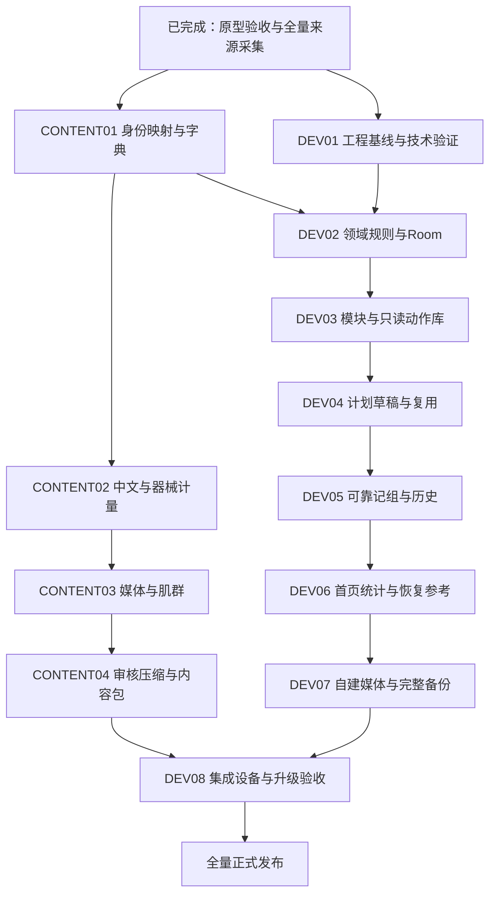

# 全量动作建设与 Android 开发计划

日期：2026-10-24。项目：`multi-tools`，当前分支`main`。依据用户最新确认：**交互原型已验收；动作由原250项全量建设进一步扩展为公开源库876条全部纳入系统。** 本文安排接下来的实际工作，不再把原型验收作为待确认事项。本轮完成全量来源采集、生产基线及开发规划，尚未编写Android健身模块。

## 1. 范围与当前事实

| 对象 | 当前状态 | 后续要求 |
| --- | --- | --- |
| 交互原型 | 用户已验收；47项规则测试的历史通过记录见14 | 用已验收行为作为实现基线，新增发现记录为具体问题 |
| 原250项候选 | 中文ID、名称、场景、器械、计量及用途已有基线 | 保留全部覆盖意图及已有EX-ID，与源库逐项映射 |
| 新增全量来源 | 已取得876条完整JSON、1,746张原图，固定提交及哈希见17 | 876条全部进入中文化和入库队列，按部位批次处理 |
| 源库缺项 | 5条无步骤说明，3条无图 | 补齐后再通过内容检查，不静默删除或使用空白教学 |
| 16份既有样稿 | 有中文和生成姿势图；专业审核通过0项 | 可作内部联调样本，复核后决定正式采用哪套图文 |
| 肌肉示意 | 17份现有SVG可用于候选制作 | 补前臂、肩部细分及全量来源新增区域；审核主要/辅助映射 |
| Android功能 | 尚未开发 | 按本文DEV01—DEV08实施；浏览器通过不替代设备通过 |

**876是本次来源处理规模，250是原需求覆盖基线，两者不能相加后宣称有1126个正式动作。** 同一动作的别名合并，同一动作不同器械/支撑/计量变式按语义区分；源库没有的原候选另补来源或原创。最终正式唯一数量在映射完成后统计，明确每条源记录及每项原候选去了哪里。用户要求的全量内容不能在内部小批次交付时被悄悄缩减。

### 首版功能基线

纳入已验收的今日/计划/动作库/统计及管理；包含18项体验优化中的统一草稿保护、缺项定位、独立动作选择、多日批量/复制、聚焦记组、批量补记及撤销、归档原安排、统计追溯、自建图片、收藏/最近和个人单日模板。保留教学图片滑动及放大。

随机推荐、重量/强度、组间计时、重复周计划、多草稿、云同步和动作识别继续列为后续；本轮不借全量内容建设扩张这些功能。动图作为合格素材的增强项，完整静态教学是每条动作的交付要求。

## 2. 总体推进顺序

内容和功能按两条工作流推进，共享同一套稳定ID、内容版本和计量字典。这里的并行指任务依赖，不要求另开聊天或代理。



内部每一批都可产出可安装的验证包，使用真实但明确标记的待审内容；正式发版要同时满足功能和全量内容出口。不能将16样稿包命名为876动作正式版，也不必等全部中文编辑结束才开始模块、数据库和记组实现。

## 3. 内容工作流：全量876条及原250覆盖

| 顺序 | 工作包 | 具体任务 | 产物与完成标准 |
| --- | --- | --- | --- |
| 已完成 | 来源采集 | 固定free-exercise-db提交；拉取完整JSON/原图/Schema/许可，核对图片Git blob和SHA-256 | 来源876条、原图1746张；缺项单独列出，见17；不是教学审校通过 |
| 1 | CONTENT01 身份与分类 | 对原250逐项建立来源映射；全876条确定规范动作及变式；已有EX-ID保留，新增ID统一分配；建立别名与重复关系 | `catalog-master.json`、`source-mapping.json`；876源ID及250原ID均有处理结果，无重复正式身份或未解释丢项 |
| 2 | CONTENT02 中文与计量 | 统一中文名称/英文别名、简介、准备/过程/还原、关键提示；核实主归属/用途、次或秒、整体或每侧；补训练凳/固定点/空间等器械条件 | 逐条中文内容及依据；源category不直接当用途，源equipment不直接当完整器械集合；5条无步骤另补 |
| 3 | CONTENT03 教学与肌肉图 | 对应具体变式选用原图；不匹配或缺失的重做；补3个无图源条目；制作列表封面/步骤图/肌肉映射，复杂动作补中间帧 | 每条有可辨识教学和肌肉区域说明；原图、改作、原创来源分别留档；未审内容不标“标准动作已审核” |
| 4 | CONTENT04 审校与入包 | 核对图文、器械、左右口径、肌群、难度及许可；检查解码、长名/小屏、压缩、缺图；生成可离线包及署名 | `release/<版本>/`：目录、媒体、清单、哈希及署名；正式条目逐项通过检查；全部源记录和原覆盖均有结论 |

### 3.1 全量库带来的字典扩展

本次实读源数据包含17种主要肌群；除原有主部位外，还有`neck`等内容。源器械包含杠铃、绳索、曲杆、壶铃、健身球、泡沫轴、药球、训练机及未知项。

- 在CONTENT01增加“颈部”目录/字典候选，对背部、腿部等保留教学细分。颈部动作不能为了套用旧11分类强行标为肩部；新增主归属的最终定义与图例在映射时一起确定。
- 奥举、力量举、强人、增强式等源category保留为来源/动作属性，经逐条核对后再映射到本项目用途。它们不自动等于适合初学者，也不作为随机推荐默认池。
- `other`或空器械保留为待补，不能当作徒手；哑铃字段继续补数量、训练凳、支撑和固定条件。用户的默认器械仍为徒手/哑铃/弹力带，健身房内容可通过全部器械查看。
- 源库未提供可靠的逐动作左右和计量字段，不能用“strength都按次、stretching都按秒”直接完成入库；静态力量、交替动作及每侧口径逐条处理。
- 同一肌群可用于教学高亮，事件统计仍只按当时的一个主归属累计；内容更新不改历史统计。

### 3.2 生产批次与进度

制作顺序为胸/背/肩 → 手臂/前臂 → 核心/臀腿/小腿 → 热身/拉伸/有氧 → 源库新增部位及其他器械/技术变式。各批完成后持续扩大同一个内容包，不建立多个互不兼容的动作库。原250项的13批数量见16，876条逐条队列见`source-intake.json`。

进度按“已采集、已匹配、中文完成、媒体齐全、肌群/器械/计量复核、许可、专业教学审核、打包通过”分别累计。字段填写或图片下载不能自动推进专业审核。审核中发现的重复、不可用或不匹配条目应修正/重制并保留处置关系；不能用数量掩盖空白或错误。

专业教学审校的责任安排目前仍需落实；采集、整理、自动检查及内部功能开发继续推进，正式内容发布保留此项出口。

### 3.3 媒体和包体策略

已取得原图总计98,671,281字节，约94.10 MiB；这是1746份源图体积，不是APK大小。现有16张生成PNG合计约27.93MB，是另一套待审素材，正式包不因两套都存在就重复打包。

列表只读缩略图，详情按需读当前动作步骤图；肌肉底图与区域共享。先拿来源中的徒手、凳上哑铃、绳索、训练机、复杂动作等代表条目做JPEG/WebP尺寸与压缩对照；压缩后变大则保留合格原格式。不要为统一后缀牺牲可读性或增加体积。

建议先以**静态全量内容约120 MiB**作为压缩与缩略图预算的评估线，最终依据补图数量、有效目录及真机显示测量调整。记录源文件、发布媒体、APK压缩后增量、安装后空间、首屏解码和连续浏览峰值；不能把文件大小当作内存，也不承诺未经测量的最终APK大小。采用与控件尺寸匹配的解码和采样，依据[Android大图加载说明](https://developer.android.com/topic/performance/graphics/load-bitmap)。

首版目标是全量内容随包、训练时离线可用。若体积与教学质量冲突，先调整媒体和构建方案并报告实测，不擅自减少动作或改成训练时联网加载。

## 4. 项目接入与编码边界

### 4.1 已核对的项目事实

- 工程采用`app → feature → core`，现有工具是electricity/diet；`settings.gradle.kts`目前没有fitness模块。
- 新工具实现[ToolModule](../../android_app/core/navigation/src/main/kotlin/com/pockettoolbox/core/navigation/ToolModule.kt)，由[PocketToolboxApp](../../android_app/app/src/main/kotlin/com/pockettoolbox/PocketToolboxApp.kt)组合注册；应用壳不承接健身业务。
- 依赖创建沿用[PocketToolboxApplication](../../android_app/app/src/main/kotlin/com/pockettoolbox/app/PocketToolboxApplication.kt)及现有功能依赖容器的方式；复用已有Room/Coroutines/Serialization及Compose版本，不顺带升级依赖。
- 主题沿用[PocketToolboxTheme](../../android_app/core/designsystem/src/main/kotlin/com/pockettoolbox/core/designsystem/ToolboxTheme.kt)和ToolboxColors三套浅色方案。卡片、间距、按钮和表单参照已有模块，以MaterialTheme语义色为主，不在每个页面重建配色系统。
- [BackupContributor](../../android_app/core/backup/src/main/kotlin/com/pockettoolbox/core/backup/BackupContributor.kt)目前只约定JSON，不能独自代表已完成带图片的完整健身恢复。

### 4.2 目录安排

```text
content/fitness/
  pilot/                          现有16样稿，保留历史
  sources/free-exercise-db/        源JSON、Schema、许可、逐图哈希
  source-archives/                 完整原始ZIP本地备份（Git忽略，迁移需携带）
  scripts/                        采集快照、基线、入库队列及后续内容构建检查
  production/
    baseline.json                 原250项覆盖基线（生成）
    source-intake.json             全876条来源队列（生成）
    progress.json                 人工进度与问题记录（后续创建，不被生成脚本覆盖）
    catalog-master.json           正式ID、中文/器械/计量/肌群主数据（后续）
    source-mapping.json           源ID及原250项到正式ID（后续）
    media/<动作ID>/source/         实际采用的原图及来源
  release/<内容版本>/              审核后的可离线构建产物
android_app/feature/fitness/
  build.gradle.kts
  schemas/                        Room schema及后续迁移
  src/main/kotlin/com/pockettoolbox/feature/fitness/
    FitnessModule.kt
    FitnessFeatureDependencies.kt
    domain/                       模型、Repository契约、日期/记组/统计规则
    data/                         Room、资产内容读取、媒体与备份
    presentation/                 今日、计划、动作库、统计、管理及共用组件
  src/main/assets/fitness/         catalog、media、attributions与内容清单
  src/test/                       领域、ViewModel、Room本地测试
  src/androidTest/                真机/模拟器页面、数据库与文件恢复
```

内置内容只读；用户动作、偏好、计划、事件、收藏和模板写独立`fitness.db`，用户图片写应用私有目录。正式应用不预置演示训练记录、不使用固定2026-10-23作为今天。开发辅助缓存仍放已忽略的`prototype/dist/fitness-acquisition`，已采用原素材另存生产目录，避免构建清理造成唯一原件丢失。

## 5. 数据设计在页面之前完成

下表为DEV02的设计任务，尚不是已经建好的Room表或最终DDL。

| 对象 | 必须落实的约束 |
| --- | --- |
| 内容目录 | 正式动作ID、source ID映射、内容版本；内置定义与用户动作分开；索引需支持中文/别名/器械/主部位检索 |
| Plan / PlanDay | 计划身份和草稿/生效/归档；计划日以自然日存储；训练/休息/未安排不同；同计划日唯一 |
| PlanItem | 同计划日同动作唯一；独立itemId，停止重加复用；用途/单位/左右/主归属快照随历史冻结 |
| SetEvent | 全局requestId幂等、有效/撤销、补记batchId、操作时刻/实际时刻/时区及当时目标快照；撤销后重记保留旧事件 |
| Draft | 单份草稿、属于新建还是编辑、步骤/日期/选项/未完成目标；草稿不进入任务和统计 |
| PersonalExercise / Media | 用户动作稳定ID、版本/停用；图片文件不可变引用、哈希/尺寸、资源代次，旧历史不跟着重分类 |
| Favorite / Template / Preferences | 收藏引用稳定ID；模板保存目标而非完成事件，应用生成新itemId；器械和提醒不删除记录 |
| MediaGeneration / RestoreJob | 数据库保存有效资源代次，导出/恢复任务互斥和状态；启动后能区分旧可用代次、已提交新代次和未提交暂存 |

关键规则必须先有Kotlin验证：

1. 有效组数校验与新增事件在同一事务内；快速连点、请求重试、目标达成、未来/归档拒绝均可复现，UI禁用按钮不是唯一保护。
2. `ordinal`是展示序位；不能设计一个无条件唯一约束，导致“撤销第2组→重记第2组”被旧撤销事件永久阻止。
3. 保存计划一次替换其必要结构，保留有历史条目；有完成或撤销历史的日期不能通过批量覆盖绕过保护。
4. 只记一组不补造实际次数/秒数；左右数据独立空缺，未知时刻保持空。批量撤销只影响对应batch，不撤销后来无关记录。
5. 显示今天按设备当前自然日；历史训练日不会因时区变化重算归属。跨午夜继续旧日有明确上下文，不能刷新后偷偷换日。
6. 首页/统计从有效事件及快照聚合；先限定日期/计划范围，再批量查询关联，不逐动作查询、不把一对多关联放大计数。用实际DAO查询验证索引与执行计划。
7. 保存返回成功才显示确认；草稿的输入暂存可合并短时间变更，但离开、切步骤及进程重建要正确落盘或明确失败，不能只存在Composable局部状态。

异步访问与状态订阅沿用` suspend / Flow / ViewModel UiState`，不在主线程解码大图或查询数据库；参考[Room异步查询说明](https://developer.android.com/training/data-storage/room/async-queries)，以本项目已锁定的Room版本能力为准，不照搬文档中的新版本依赖。

## 6. Android逐阶段执行单

| 顺序 | 阶段 | 工作及交付 | 完成出口 |
| --- | --- | --- | --- |
| 1 | DEV01 工程基线与高风险技术验证 | 核实本机JDK/SDK/Gradle/ADB与现有电费/饮食构建；做小范围图片降采样和媒体代次恢复验证；确定内容包Schema、大小/数量限制 | 基线结果有日志；损坏图/中断切换能保持旧资料；产出正式数据/备份设计。旧文档D盘路径不是本机当前验证结论 |
| 2 | DEV02 领域与Room | 新增独立模块骨架、领域类型/规则、DAO/Repository、独立库和schema；实现计划、事件、草稿、个人动作、收藏/模板的持久化契约 | 事务、幂等、撤销重记、日期/计量与多计划聚合测试通过；不修改其他工具数据库 |
| 3 | DEV03 模块入口与动作库 | 接入工具注册/依赖；实现类别首页、主练/辅助、全库搜索/筛选/分批、双图列表、滑动教学/放大/来源、收藏/最近；读取同一内容包 | 飞行模式可浏览；876规模下按需加载；返回保留查询和位置；缺媒体可恢复，长名和三主题可用 |
| 4 | DEV04 计划与复用 | 四步、单日快捷、全入口草稿保护、独立选择器、目标/缺项定位、多日批量/复制、个人单日模板、选中日编辑与归档 | 重启保留草稿；失败不变更生效计划；含撤销历史仍受保护；复制目标不复制记录；重复动作打开原安排 |
| 5 | DEV05 可靠训练闭环 | 当前动作聚焦、一击完成、编号撤销、手动下一动作、教学返回、组明细/实际值、批量补记/撤销、停止重加 | 数据库与画面组数一致；快速点击、后台/进程重启、跨午夜、历史/未来和归档分支通过；最初“忘记做到几组”问题可实际解决 |
| 6 | DEV06 首页与统计 | 连续日期轴、两张概览、正确主操作、未完成定位；7/30/自定义、计划/用途/部位/动作/实际值覆盖率、追溯；按计划部位恢复事实 | 10中的手算样例与数据库聚合一致；多计划不重复天次；辅助部位不重复算组；恢复不生成精确完成时刻 |
| 7 | DEV07 自建媒体和完整备份 | 自建/复制/编辑/停用与引用影响；系统选图后持久化私有副本；完整ZIP导出/预检替换、媒体代次和启动恢复 | 换机恢复含图、草稿、模板/收藏、归档/撤销/实际值；损坏、缺图、空间不足、中断、重复恢复失败不丢旧资料 |
| 8 | DEV08 集成与发布验收 | 全量内容构建检查；Android单元/数据库/页面/文件测试、lint、debug/release；升级旧应用、三主题/小屏/大字体/读屏/性能/离线 | 功能与全量内容出口均满足；原电费/饮食数据和功能保留；版本号/签名/安装包、内容版本及校验记录齐全 |

DEV01的备份验证只用最小资料验证机制；DEV07再补完整功能与异常矩阵，两者不是重复实现两套备份。DEV03的内部联调可先读取16样稿，最终同一读入逻辑切到全量包，不另建永久16条测试架构。

DEV04完成时已经可以配置计划；DEV05完成时形成第一个实际可训练的Android内部版本。之后连续推进，不要求用户重新确认已经验收过的同一套原型。

## 7. 备份与文件专项任务

采用独立健身ZIP包，内含`manifest.json`、业务JSON、个人图片及哈希；内置动作媒体只存内容版本/身份引用，不在每次备份重复放入全部1746张图片。还原设备缺少对应内置版本时，保留历史快照并说明教学缺口，不能把缺图写成训练事实丢失。

现有`BackupContributor`可复用JSON元数据与校验契约；完整包由fitness内部Archive服务组织，不更改电费/饮食JSON格式，不给用户一个表面完整却不含个人图片的同名导出入口。文件选择读写使用系统SAF，具体URI与错误处理依据[Android文档文件访问说明](https://developer.android.com/training/data-storage/shared/documents-files)。

执行顺序：

1. **导出快照**：在一致的数据库快照下固定引用；个人媒体用不可变文件引用，导出期间保护其不被清理；流式打包，显示阶段和失败。源包先做完整性检查，写出结果和实际验证范围分别记录。
2. **导入暂存**：先限制输入总量、条目数、展开量和图片像素；拒绝路径穿越、重复条目、非法文件名、哈希/关联/版本/解码错误。只检查ZIP是否能打开不算预检通过。
3. **预览替换**：列出现有→备份的计划、事件、用户图片及未提交草稿影响；取消不写业务资料，确认后暂时阻止健身写入。
4. **原子切换**：新媒体目录准备齐全后，在fitness数据库事务内替换资料并切换activeGeneration；提交前失败继续使用旧库/旧代次，提交后读取已准备完整的新代次。
5. **中断恢复**：模拟解包中、媒体准备后、事务前/后等中断；启动时按已提交代次恢复，不根据“目录最新”猜测。确认无引用后再清理旧资源，清理不作为事务成功的前提。
6. **完整复验**：将带图片、草稿、模板、收藏、撤销及实际值的包导入另一份空环境核对；保留不支持版本、磁盘不足及重复导入案例。正式容量上限根据专项实测制定，不直接照搬浏览器20 MiB。

## 8. 每阶段验证与交付规则

- 内容脚本检查：源ID和正式ID映射完整、必填字段、计量/用途、器械组、肌肉引用、媒体存在/哈希/可解码、署名及审核状态。生成文件与人工进度分开，重建不会清空人工审核结果。
- 规则迁移：将原型47项场景作为追溯基线，用Kotlin/Room覆盖相同行为；不能只把JavaScript测试计入Android通过数。
- 数据库：事务失败、双击/重试、撤销后重记、历史覆盖和恢复切换分别验证；迁移schema留档，不用destructiveMigration销毁用户数据。
- UI：本机可运行的测试与真正设备分别记录；覆盖Android 8/API26最低版本、较新系统、小屏、键盘、旋转/后台重建、大字体、读屏和左右滑图冲突。原生触控区按Android项目规范验证，不把44 CSS px当成dp。
- 性能：全量目录检索、连续滑动图片、长日期计划和建议1万/10万事件数据集测量。记录设备、耗时/内存/查询，不凭文件大小或SQL外观宣称性能通过。
- 回归：现有电费/饮食的规则、备份、主题和升级资料全部保留。新增权限、网络、依赖和APK大小通过Manifest/构建结果核对，保持离线定位。
- 交付：每阶段提交范围清楚，附功能、验证结果和真实缺口；阶段性内部包明确标记内容状态，正式包使用正式签名与版本，并输出SHA-256。

建议的验证命令在fitness模块建立后执行，本轮未运行这些Android任务：

```powershell
.\gradlew.bat :feature:fitness:testDebugUnitTest :app:assembleDebug
.\gradlew.bat :feature:fitness:connectedDebugAndroidTest
.\gradlew.bat :app:lintRelease :app:assembleRelease
```

现有模块回归另执行其对应任务；连接设备、SDK/JDK及构建环境是否满足，先由DEV01核实。

## 9. 接下来直接执行的第一批

1. CONTENT01：先将原16样稿与876源库准确匹配，再逐批处理原250及剩余来源，确定正式ID、分类/器械/计量字典和问题记录。
2. DEV01：核实当前机器的Android构建基线；以现有来源图验证缩略图/详情解码，同时做最小媒体代次切换实验。
3. 根据两项结果完成DEV02的Room结构及内容包契约，然后持续进入模块、动作库和计划实现。

**当前可以进入Android技术验证和基础开发准备，用户原型验收已完成。** 最终正式发布仍需全量内容、专业教学/来源检查、真实媒体恢复与设备出口；这些列为后续具体工作，不再当成重复讨论需求的理由。
