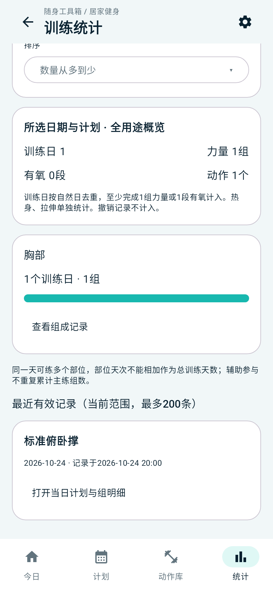
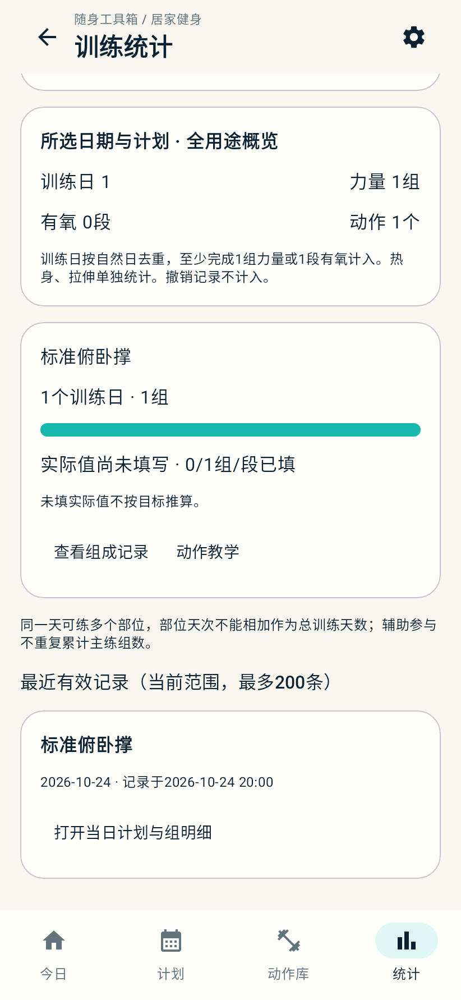
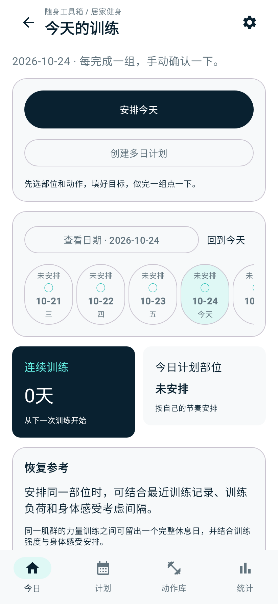

# 原型对照与本机验证记录

日期：2026-10-25。基线为 `main` 的 `9386f52`，对照 `prototype/fitness` 和设计文档04、06、12、14。此次检查包含实际 Android 构建、领域规则、Room、ViewModel、页面交互和打包后素材；没有把源码检查算作真机验收。

本文为首次原型对照阶段的历史验证记录。当前v1.2.0已按用户确认纳入正式应用，版本、发布开关及最终验证见[21](21-v1.2.0正式发布.md)。

## 1. 素材补齐与构建

- 已从固定来源提交 `f00c92c7dcf1216a928a52c3706c7ce8e2f71ed5` 重建缺失 ZIP：99,702,843 字节，SHA-256 为 `3fad20f601ee50376781ecc41fcff9674ccaaff3427a4c397f472496e23a4982`，与既有台账完全一致。
- 新增 `content/fitness/scripts/restore-source-archive.ps1`，迁移后可显式下载、重建并校验。原包及下载缓存都在项目的 D 盘目录内，由 Git 忽略；不改来源版本或审核状态。
- 修复 AGP 9.4 旧 sourceSets 接口类型转换失败，改用 Variant API 注册生成素材。修复 ZIP 提取后多出原仓根目录的问题；此前 APK 虽有图片，但应用按目录索引找不到原图。
- 修复 AGP 本地测试资源 APK 的增量依赖，确保素材路径变更后不会继续测试旧资源包。
- 修复4处中文字符串紧邻 Kotlin 插值变量导致的编译错误。
- 使用本工程 JDK17、Gradle9.6、AGP9.4、Kotlin2.3.21、KSP2.3.12 与 SDK37；缓存位于 D 盘。保存首次真正由 KSP 生成的9表 Room v1 schema。

## 2. 按功能点核对

下面的“主机”指 Robolectric 的 Android 环境，数据库和图片测试启用 Native SQLite/Graphics；不等同于在手机上执行。

| 功能 / 原验收编号 | 核对与修复 | 验证范围 |
| --- | --- | --- |
| 离线目录、分类与内容 A01 | 876条来源、16份中文样稿、17个肌肉SVG；逐一打开生成资源中的1746张原图及16张样稿并解码 | 内容检查、主机 Android 资源读取；专业审核仍为0 |
| 搜索、器械与主辅部位 A02–A04 | 器械组全部满足、替代组任一满足；双哑铃不等于已有训练凳；主练与辅助筛选分开；清空筛选恢复默认 | 规则测试、页面代码对照；细分肌群图仍有原设计中的缺口 |
| 多图、放大、无图退路 A05 | 保留滑动、页码、放大、失败重试及文字说明 | 素材解码测试、代码对照；真实手势待手机验证 |
| 日期范围与重复动作 P01、P02、P06 | 首尾包含，最多366天；同日按动作身份去重，不跨计划合并 | 领域及 Room 测试 |
| 部位与训练/休息/未安排 P03、P05、P08 | 移除部位前确认受影响安排；力量部位必须有主动作，辅助参与不能凑数 | 规则测试、确认入口代码对照 |
| 复制、批量与模板 P04 | 复制目标及新条目身份，不复制完成事件；含撤销历史也禁止整日覆盖 | 规则及 Room 测试 |
| 四步计划与未填完输入 P07 | 保存前显示缺项；补齐预览中的休息、未安排和待补日数量；有符号文本不再被静默转换为合法目标 | 领域、ViewModel测试 |
| 草稿与退出 P09 | 自动暂存、读取失败保留输入、失败禁止离开、重试、替换保护；修复继续草稿后日期/步骤不自动暂存 | ViewModel测试，含重建后恢复未填完文本 |
| 归档与旧草稿 P09、E03 | 修复先暂存、后归档、再保存旧草稿会绕过“取消归档”的问题；数据库边界拒绝普通编辑解封归档 | 共享 Room 回归，失败保留草稿 |
| 记组、上限与重复确认 T01–T04、T07 | 保存成功后才改变进度；事务保证同请求幂等、并发不超目标；补上与原型一致的650ms短连点保护，失败可立即重试 | Room并发测试、ViewModel测试 |
| 撤销、重记与批次 T05、T06、T14 | 保留撤销事实，重新按有效事件排序；整批撤销不影响后来单独记录 | 规则与共享 Room 测试 |
| 多计划、切日与跨午夜 T08–T10 | 修复日期选择未被 Compose 观察及旧进度残留；已有训练上下文可继续原日；随系统时区更新“今天”，不搬动历史日期 | ViewModel、Room、时区测试 |
| 历史补记 T11 | 仅日期与手填训练时刻分开；明细补充实际的补记操作时间，不将操作时刻伪装为过去训练时刻 | 规则及时间文案回归 |
| 次/秒/每侧 T12、T13 | 手动确认只增加组/段；目标不自动变成实际次数；实际值可清空、左右分别填，并提供明确的同值/按目标填写操作 | 领域、统计、Room测试；输入键盘待手机验证 |
| 改目标与历史快照 E01、E02、E04、E06 | 不少于有效已完成数；旧事件目标、身份、用途和计量不随修改重写，即使历史已全部撤销 | 领域和 Room 测试 |
| 停止、重加与历史入口 E05、H05 | 同日重加恢复原身份和目标；已停止动作新增完成/撤销明细入口；不产生0/0或清空过去事实 | 领域、Room测试及页面代码对照 |
| 首页时间轴与今日卡 H01、H02 | 保留连续自然日；补上有记录日期的标记及数量；已练主部位从真实事件聚合，不局限于仍在安排中的动作 | Room日期聚合、页面截图和代码对照 |
| 连续训练与不同用途 H03、H04 | 力量、有氧计入训练日；热身和拉伸独立，不能凑力量组数 | 统计规则测试 |
| 统计范围及天次 S01、S02 | 近7/30天、自定义、计划及用途；补齐原型中的数字条形图、天次/组数切换、固定/数量排序及每日记录入口 | 聚合、筛选测试及页面交互测试 |
| 实际值与覆盖率 S03 | 未填显示“未填”，不再用0误导；次数、秒数、左右口径分组，目标不冒充实际值 | 规则、Room和暖白主题页面测试 |
| 统计刷新、历史及追溯 S04–S06 | 归档历史仍参与默认统计；撤销、删除、恢复按事件重新计算；组成记录可跳回原计划日再返回 | Room及页面交互测试 |
| 明细弹窗重建 | 保存筛选范围与加载数量，重建后重新订阅记录，修复仅保留标题却丢失查询的问题 | Compose保存状态恢复测试 |
| 恢复参考 R01–R05 | 保留事实来源、主辅关系、仅日期降级、异常时刻处理，不声称恢复百分比，不阻断正常记组 | 既有统计规则测试、代码对照；本轮未新增医学建议 |
| 个人动作 | 修改/停用不改已有安排与历史；保留图片导入、明确复制来源及器械选择 | 规则、Room及图片测试 |
| 带图备份和换机 B01 | ZIP包含业务、个人图片、收藏、模板、偏好、草稿；修复图片校验文件句柄未及时释放及恢复后草稿未立即回显 | 主机图片往返、ViewModel与页面测试 |
| 无效包与失败回滚 B02 | 校验版本、路径、哈希、引用、容量和图片；事务失败保留旧指针/旧图片；导出展开容量现包含manifest，与导入一致 | ZIP规则及注入提交失败的共享 Room/媒体测试 |
| 三主题与导航 U02 | 清爽、暖白、纯白主页面实际渲染；健身选中态改用现有薄荷色，避免系统默认紫色混入；修复从动作库打开原计划后的返回目标 | 4项主机页面测试、截图查看 |
| 小屏、横屏、键盘、触摸及读屏 U01、U03、U04 | 检查滚动、输入和点击区域代码；主机截图采用411×891dp测试视口 | 未连接手机，无可用AVD；不宣称IME性能、横屏/大字体/读屏已验收 |

## 3. 复现命令与证据

在仓库根目录补齐源包，然后在使用已有 Java17/SDK37 的环境执行。Windows 推荐使用英文目录入口 `D:\Program\multi-tools`。不要将源码中的示例目标次数当作训练建议。

```powershell
.\content\fitness\scripts\restore-source-archive.ps1
python android_app/feature/fitness/validation/check-content.py
python android_app/feature/fitness/validation/check-sql.py
node --test --test-isolation=none prototype/fitness/model.test.mjs prototype/fitness/plan-picker.test.mjs prototype/fitness/experience.test.mjs
cd android_app
.\gradlew.bat :core:common:test :core:backup:test :feature:electricity:testDebugUnitTest :feature:diet:testDebugUnitTest :feature:fitness:testDebugUnitTest :app:lintDebug :app:assembleDebug :app:assembleRelease :feature:fitness:assembleDebugAndroidTest --max-workers=2
```

`validation/check-apk.py`进一步读取最终APK，核对全部目录引用及1746张来源图片的逐文件SHA-256；指定`--release-apk`时同时确认正式包未携带开发健身素材。执行设备测试使用`:feature:fitness:connectedDebugAndroidTest`，本轮没有连接设备，因此只构建设备测试APK并在主机执行共享存储测试。

测试报告位于模块`build/reports/tests/testDebugUnitTest/`；页面截图位于`feature/fitness/build/reports/fitness-ui/`，使用构造的示例记录，不含用户真实数据。构建日志保存在忽略目录`outputs/`。

最终验证结果（2026-10-25）：

- JVM/主机测试共179项全部通过，无失败、错误或跳过：公共规则5、电费51、饮食29、健身94。公共备份模块无独立测试源，不计入通过数量。
- 原型Node测试47项全部通过。内容检查通过，SQLite检查核对9表和42条DAO查询。
- Debug、Release及健身设备测试APK均构建成功。17项共享存储测试已在Robolectric运行，设备测试APK仅完成编译，未在手机运行。
- App Lint为0错误、17警告；健身模块单独Lint为0错误、6警告。警告不计作已修复，保留报告供后续维护。
- 最终Debug APK的1762条图片路径、1746张来源图片逐文件SHA-256及17条SVG路径校验通过；Release包确认不含开发健身素材。两种APK均通过apksigner签名校验。
- 独立包名重新构建后，Debug APK为148,614,031字节（约141.73MiB），Release为14,266,443字节（约13.61MiB）。Debug包含完整离线原图，因此明显大于正式包。
- 本轮测试包保存在忽略目录`outputs/multi-tools-fitness-debug-20261025.apk`，旁附`.sha256`文件。后续已将Debug改为独立包名`com.pockettoolbox.debug`、名称“随身工具箱·测试版”、版本名称`1.1.0-debug`，可与正式版`com.pockettoolbox`同时安装在同一手机。两者数据库、图片和偏好各自独立；需要正式资料时在对应工具手动导出、导入，卸载测试版不影响正式版。旧的同包名测试包已由重新构建的独立安装包替换。本轮未发布GitHub Release。
- 独立包名构建的Debug/Release Lint均为0错误、17警告；使用aapt读取最终APK，核对包名、中文名称、版本、启动Activity、Application类、调试标记和无共享UID。两包的Startup Provider authority及自定义签名权限分别使用各自包名前缀，无重叠；apksigner验证通过，正式版沿用既有正式签名。原图资源校验再次通过。检查结果保存在`outputs/parallel-install-verification.json`，构建日志为`outputs/parallel-install-build.log`。Release另存为`outputs/multi-tools-release-20261025.apk`并附哈希文件。本次未执行手机安装测试。

下列为Robolectric构造示例的页面截图，不是真机截图，也不含用户真实资料：

| 清爽主题统计 | 暖白主题统计 | 纯白主题首页 |
| --- | --- | --- |
|  |  |  |

## 4. 发布边界与手机验收

`releaseApproved=false`保持不变。开发包包括876条英文来源及16份中文待审定义，专业审核仍为0。Release不注册健身入口、不携带这些开发媒体。完成代码测试不代表876个教学动作已全部完成中文、器械、计量和专业审核。

本机尚不能证明：真实手机上的安装/升级、系统文件选择器权限与取消、输入法和滚动性能、横屏/大字体/读屏、后台与系统杀进程、低磁盘空间、恢复提交瞬间断电，以及接近512MiB的备份容量与内存峰值。请在手机上按“建计划→记组→撤销→补记→统计→自建带图→导出→恢复”执行闭环，再检查这些边界。保留既有电费与饮食资料，各工具分别备份。
