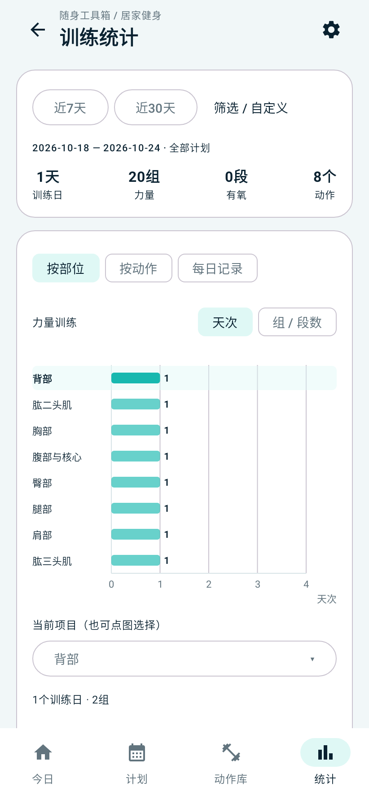
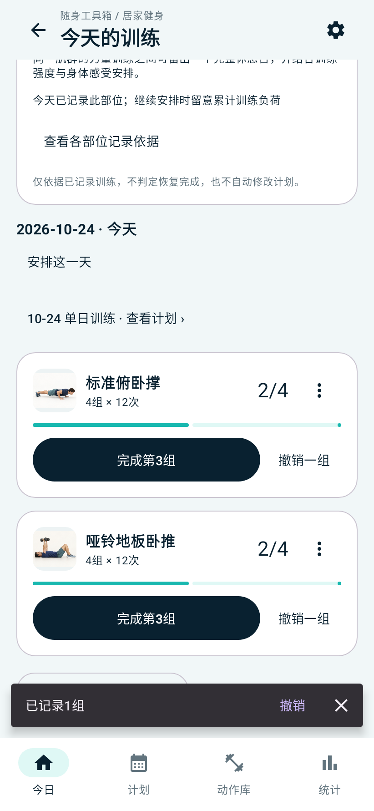
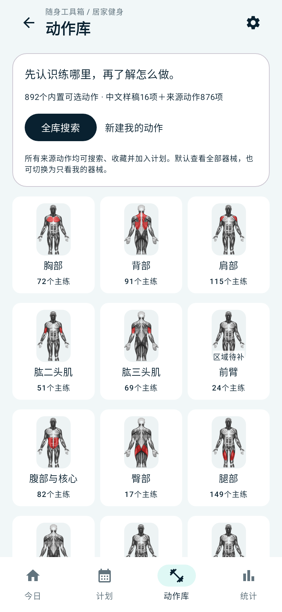

# 统计图、全量动作与自由记组

日期：2026-10-25。用户在单手机并存测试包中反馈：统计卡片过长、只能选择16个动作、记录其他动作前必须切换聚焦。本轮按这三项反馈修改原生实现，保留测试版独立包名。

本文记录发布前测试包阶段；随后用户确认初版，v1.2.0正式发布配置与验证见[21](21-v1.2.0正式发布.md)，正式包已包含健身与来源素材。

## 统一坐标图

- 默认顶部只显示近7/30天、范围和四项概览。自定义日期、计划、用途和排序放入“筛选 / 自定义”。
- 部位或动作放在同一张横向柱状坐标图中，所有柱共享数值刻度和网格，每条显示具体数值，可切换天次与组/段数。图高固定280dp，最多12项一页，超过时在图内翻页；各页沿用同一量程，比较不会因翻页失真。
- 点击柱或“当前项目”选择器后，显示该项目的概览、实际值填写覆盖和组成记录；动作教学保留入口。日常统计不再自动铺开每个部位的大卡片和200条记录，明细通过点选或“每日记录”打开。
- 实际值未填仍显示未填，目标不冒充实际值，撤销记录仍不计入。

## 全量来源接入计划

- 原始目录保留16份中文样稿和876条来源记录。加载后产生892个可选条目，共用动作库、分类、搜索、收藏、最近练过及计划选择器。
- 来源记录使用`SRC-原始ID`，名称、图片、步骤和版本可追溯。11份中文样稿存在候选源对应，未进行未经确认的身份合并；892为可选条目数，不是已审校的唯一动作种数。
- 主辅肌群映射到既有分类，来源器械未知不当作徒手。分类和全库默认显示全部器械，用户仍可开启器械偏好筛选；器械标签保留来源粒度，附加支架等条件需按原图查看。
- 来源拉伸、有氧默认以秒记录，其他默认以次记录；在计划“动作与目标”中可调整单位和合计/每侧口径，修改后重新填写目标。有任何完成或撤销历史时，口径锁定，避免破坏历史。
- 来源动作可直接加入计划，个人动作复制功能继续保留。原图沿用既有离线资源，不重复复制为个人媒体。

## 自由顺序记组

- 今日和计划日共用训练卡片，每个动作一直保留独立按钮。记录A后，可以直接记录B，再返回A，其他动作不会折叠成“切到此动作”。
- 卡片显示缩略图、动作名、目标、当前进度、完成按钮与撤销；组明细、教学和结束剩余安排放入更多菜单。
- 继续训练按钮只作为滚动定位快捷入口。未来日禁止记组、历史日明确补记、组数上限、防连点和事务幂等规则继续生效。

## 验证

2026-10-25验证完成，Gradle最终任务成功。四个模块共190项测试通过，0失败、0错误、0跳过：健身105项、公共模块5项、电费51项、饮食29项。健身105项在本轮重新执行；最终打包任务复用这些成功结果，未变更的其余85项由Gradle增量检查复用此前成功结果。

| 检查项 | 已验证内容 |
| --- | --- |
| 坐标图与统计 | 单图显示、柱点击进入对应明细、13项分两页且量程一致、整数刻度与大数边界、三主题导航；同日跨计划去重、撤销不计入、目标值不当实际值、左右侧实际值独立覆盖 |
| 任意顺序记组 | 在A动作已记录一组后，直接依次点击B、A、B，数据库事件顺序与进度一致，无切换聚焦前置步骤；并发重复请求幂等，完成数不超目标，撤销保留后续独立记录 |
| 全量动作 | 892个唯一条目ID，逐一校验876条来源映射及加入计划；原名、原步骤、原图均保留，未知器械不会错误归入徒手 |
| 计量与备份 | 首次记录前更改单位/左右口径会清空旧目标值并暂存；撤销历史同样锁定口径；来源动作在新数据库恢复后保持ID、计划、收藏、完成/撤销事件和左右实际值 |
| 离线资源 | 1762张目录引用图片可解码，17份肌肉SVG可解析/渲染；最终APK内1746张源图逐一核对SHA-256，目录无遗漏或多余层级 |
| 安装隔离 | AAPT验证两个不同包名、启动Provider和动态接收权限；APK签名验证通过，测试签名与之前独立测试包一致；Release不包含开发健身素材 |
| 构建与静态检查 | Debug、Release及健身AndroidTest APK构建通过；App Lint为0错误、17警告，主要为版本升级建议，另含主题图标、目标API及简化代码建议 |

关键命令：

```powershell
# 在android_app中，使用D盘JDK、SDK、Gradle缓存与临时目录
.\gradlew.bat :core:common:test :feature:electricity:testDebugUnitTest :feature:diet:testDebugUnitTest :feature:fitness:testDebugUnitTest :app:lintDebug :app:assembleDebug :app:assembleRelease :feature:fitness:assembleDebugAndroidTest --console=plain --max-workers=2
# 在仓库根目录校验最终安装包的离线素材
python android_app/feature/fitness/validation/check-apk.py android_app/app/build/outputs/apk/debug/app-debug.apk --release-apk android_app/app/build/outputs/apk/release/app-release.apk
```

本机日志：`outputs/fitness-ux-final-verified.log`保留105项健身测试执行过程，`outputs/fitness-ux-delivery-check.log`为最终成功构建日志。

测试包：`outputs/multi-tools-fitness-test-20261025-r2.apk`，149,166,488字节（约142.26MiB），同目录提供`.sha256`校验文件。

SHA-256：`d17fd33bb4555a5d3590b14ae803246748ca1b13237fc544827ce58f756c6bf2`。

以下为Robolectric运行实际Compose页面生成的截图，采用固定示例数据，不代表已在实体手机验收：

| 单张坐标图 | 交替动作记组 | 全量动作库 |
| --- | --- | --- |
|  |  |  |

仍需手机检查：覆盖安装后旧测试数据是否保留、两种应用能否同时打开；实际键盘弹出及滚动是否顺畅；按自己的动作顺序记组后查看统计；通过系统文件选择器导出并恢复健身ZIP。实体设备的`connectedDebugAndroidTest`本轮未执行。

测试包为`com.pockettoolbox.debug`，显示“随身工具箱·测试版”，可覆盖更新此前的独立测试版。正式包为`com.pockettoolbox`，数据各自独立。来源内容尚未完成中文教学和专业审核，Release健身入口仍关闭。
