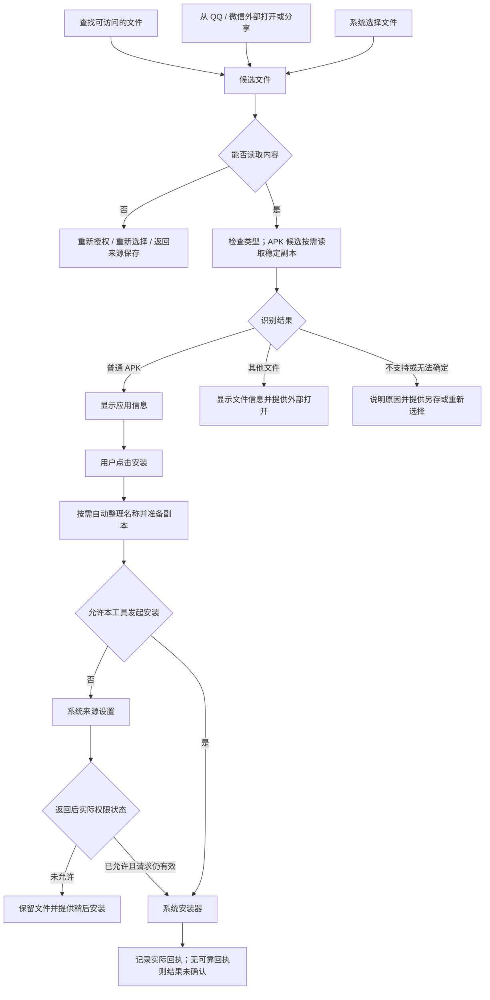

# 文件快找 · 流程状态与验收清单

日期：2026-10-29；修订：2026-10-30，复核版0.3。以下编号用于原型、开发和验收追踪，不代表功能已实现或测试通过。轻量化取舍见 [04](04-同类产品参考与轻量化评审.md)，本轮复核见 [05](05-设计复核与阶段准入.md)。

## 1. 核心流程

普通 APK 也可能因系统兼容、签名或缺少分包而不能安装。图中的“普通 APK”表示本工具未识别出集合 / 分片结构，不是安装必定成功的保证。

## 2. 分流程交互约定

### F01 首次进入与查找范围

1. 打开工具显示单首页、查找安装包、选择文件和最近使用；不在工具箱启动时要求文件或安装权限。
2. 没有可扫描来源时，选择文件仍可用；用户主动查找后再说明“当前没有查找范围”，提供授权位置与直接选择入口。
3. 范围管理中的“开启扩大查找”进入简短用途说明，再跳系统设置；“添加文件夹”进入系统允许的目录选择器；“选择文件”允许选入异常后缀。
4. 用户取消任何入口都回到原页面，不记失败次数、不反复弹窗。
5. 有范围后才能开始扫描。恢复权限时重新读取状态，不能仅根据设置页返回码判断已授权。

验收：拒绝扩大访问仍能从系统选文件；系统不可授权的目录有准确说明；已有工具完全不受新权限流程影响。

### F02 快速查找、扩大查找与搜索

1. 每次任务记录本次来源集合与扫描批次；快速查找只扫有限的常用范围，但登记范围内所有可访问普通文件的轻量元信息。安装包 / 全部、关键词等仅过滤展示；不为通用文件扫描读取正文或图标。
2. 展示“正在查找：目录名称”“已发现 N 个候选”，总量未知时不显示伪造百分比。
3. 结果增量出现，可在扫描期间搜索或停止。搜索是当前索引筛选，不因每次输入重新扫盘。
4. 同一时刻只保留一个有效扫描任务；重复点击不启动多个扫描器。
5. 被拒绝的子目录计入未覆盖范围，其他目录继续；完成时显示“已查找 X 个来源，Y 处无法访问”。
6. 仅成功枚举完整来源后才能更新该来源完整覆盖标记；停止、权限失败、超时、索引容量上限及被拒子目录均不能算完整。展示筛选不能把未匹配旧项标为消失；未见项先标“本次未发现”，重新访问明确不存在后才标“已不存在”。
7. 扩大查找时不跟随循环目录链接；重复来源引用不无限递归。
8. 扫描结果是最近一次快照。点击项时重新检查，避免缓存记录冒充当前可用文件。
9. 首版采用用户主动的前台查找：旋转屏幕不重复启动任务；离开工具或进入后台时停止扫描并保留已找到项，回到页面可继续发起查找，不承诺后台持续扫盘。暂存 / 导出中的文件操作按各自中断规则恢复。
10. 首页默认最近使用，点击搜索或查找即进入同页查找状态；扫描前和零结果时也保留安装包 / 全部。首次查文档可以直接选择全部。已有索引先展示快照，无索引则提示尚未查找；返回先恢复最近状态，再返回工具箱，详情返回保留查询与滚动。

验收：中止保留已找到项；大目录可滚动、可取消；嵌套来源不会造成无限循环；恢复刷新不重复插入同一来源标识。

### F03 从 QQ / 微信进入

1. 文件下载完成后，用户在发送端选择外部打开 / 分享，选本工具。
2. 接收文件 URI、提供方显示名称等输入；不信任 MIME、扩展名、外部提供的路径或来源标签。
3. 明确显示接收到的文件，开始读取和识别；原件不会被修改，也不会自动请求安装。
4. 临时 URI 需在有效期内完成暂存。取消时停止读取，清理未完成临时内容。
5. 无文件流、没有读授权、链接型内容或发送端内容已失效，分别展示可执行的替代路径。
6. 首版单文件优先。意外收到多文件时列出名称并要求选择一个；不偷偷只取第一个、不将多个文件自动当成分包合并。
7. 冷启动与应用已打开时都能接收；重复 Intent 不能导致重复保存、重复跳页面或自动安装。
8. 完成或取消后返回来源应用；工具箱内部原有记录或健身草稿不丢失。

不同文件的请求不按重复 Intent 丢弃。首版一次只执行一个文件处理任务，每个请求绑定不可变文件身份、操作 ID 和系统回执；同一 URI 内容变化时需重新读取，不能只用 URI 字符串永久去重。A 复制、导出、授权或安装在途时收到 B，显示“A 尚未结束”，不覆盖 A，也不自动读取或安装 B。最多暂挂一个 B；可取消的 A 需先明确取消并完成收尾，再由用户点“处理新文件”。A 已交系统时不假装可以撤销安装；待返回并核对交付状态后方可切换，未确定结束的副本继续受保护，但不永久锁死其他文件的处理。等待期间 B 授权失效则要求从来源重新打开。再次收到 C 时说明忙碌并请稍后重试，不覆盖暂挂的 B，不建立批量队列。进程退出不承诺保留临时授权，恢复后不自动安装任何暂挂请求。

安装来源权限是应用级权限，但返回的继续操作必须绑定 A；不能把 A 的“安装”意图沿用给 B。扫描与文件处理分开：从扫描结果进入详情或收到外部文件时停止扫描并保留部分结果，不争抢复制资源。

验收：QQ、微信各自验证 APK、异常名称、无可读授权、重复打开、冷 / 热启动；只对实际可行的菜单提供操作指引。

QQ 的“用其他软件打开”是用户明确要求的 P0 路径，分三个结果逐项验收：

- **能被选到**：在红米 K60 当前 QQ 版本的实际入口中，安装后的工具箱出现在可选应用中；普通 APK 与 `.apk.1` 分别验证。系统构造的模拟 Intent 能匹配，不代表 QQ 自己的列表一定展示。
- **能读取该文件**：选择工具箱后直达正确文件的详情，名称与字节内容一致；不绕回工具箱首页，不要求先授权全盘查找。
- **能交给系统安装**：确认支持的 APK 后生成副本，用户发起安装，权限往返后保留文件与结果；“已打开工具箱”不等于此项通过。

如果某一项失败，报告实际失败层：候选列表不展示、收到请求但无可读文件、解析不支持或系统安装未完成。不得统称“QQ 不支持”，也不得把只出现应用图标当成流程完成。

### F04 识别与详情

1. 列表通过名称获得 APK 候选，显示“待识别”；进入候选详情后读取稳定副本再确认类型。正常其他文件只显示文件信息，不默认完整复制或做 APK 解析；未知文件可由用户主动尝试识别。
2. 文件由公开目录读取时检查读取前后的可观察变化；暂存字节数与可靠的预期大小不符时不进入可安装状态。
3. 元数据大小 / 时间未知时如实显示，不拿 0 当实际值，也不宣称验证了完整传输。
4. 对实际待安装副本进行包信息解析。解析失败、分包特征、空文件、不支持的容器结构分别呈现。
5. 文件名与应用名不一致时同时保留，例如名称写着 `A.apk`，内部应用名为 B；不把文件名当真实应用身份。
6. 图标读取失败时显示通用图标，不让整页失效；资源加载需有限尺寸与后台执行。
7. 识别成功只用“已识别为 APK”；页面不显示“已通过安全检测”。

验收：普通 ZIP、零字节文件、伪装后缀、超长名称、未知大小、加载失败图标均有稳定界面。

### F05 整理副本与另存

1. 支持的APK统一“安装”主按钮，异常名称旁说明“会自动整理文件名，原文件保留”；完整输出名可展开查看，用户点主按钮后开始必要处理。
2. 优先复用已经完整校验的同一份暂存副本，避免连续生成多个大文件。
3. 先写临时对象，完成后再将其登记为可用副本；失败不保留一个看似有效的半包。
4. 应用内存储使用稳定内部标识，面向用户显示名称；不能让输入文件名决定任意写入路径。
5. 输出名冲突时生成扩展名前编号。若要另存到外部，使用系统保存界面，展示实际结果。
6. 外部写入失败或取消时，保留应用内有效副本；对本次创建的外部未完成文件做可行的清理，清理不了则告知位置与未完成状态，不触碰已有文件。
7. 再次分享应分享正确名称的完整副本；若接收方再次追加后缀，本工具无法控制接收方命名。
8. 应用内副本属于受控短期暂存，按04的期限与空间规则回收；主动另存的外部文件不自动清理。文案不能继续承诺所有副本永久保留。

验收：同名不同内容不会覆盖；取消、断电模拟、空间不足时原件完整；导出名称最后仍为 `.apk`，或如实报告提供方返回异常名称。

### F06 请求安装与返回

1. 安装必须由用户点按钮发起。复制成功不是安装成功。
2. 未授予安装来源权限时保留待处理文件和本次操作，跳系统设置。
3. 返回后，只有确认仍为同一有效用户请求、文件仍可用且权限已开启时才继续；进程重启、文件变化或请求过期则显示“继续安装”，不自行弹安装器。
4. 系统安装器由用户确认；用户取消后仍能另存或稍后重试。
5. 只有可靠的安装结果回执才能记录成功。单纯 `onResume`、界面返回、或查询发现手机原本已安装同包名应用，都不足以证明本次成功。
6. 可靠返回失败原因时展示对应信息；没有原因时写“安装未完成 / 结果未确认”，不编造签名冲突或低版本原因。
7. 签名冲突、降级限制、系统阻止、缺少分包等不能通过继续改后缀解决；不默认引导卸载旧版，以免丢失旧应用数据。
8. 安装器仍可能读取文件时，管理页不能直接删除正在使用的副本；占用与解除按F09处理。
9. 安装包是工具箱自身更新时仍交系统确认。更新可能结束当前进程，先持久化请求与副本状态；新版本再次打开先恢复记录，不自动重发安装，不因当前版本号已变化就伪造本次安装成功回执。

验收：来源授权往返、取消、已安装旧版、结果未知、多次点按钮均不重复自动安装。必须记录“请求安装”与“实际安装结果”的区别。

### F07 其他类型文件

首版对正常文档、压缩包等支持查找、查看文件信息、外部打开或另存；不内置内容编辑器。`.pdf.1` 等可以在“全部”找到，但首版不给出未经验证的格式修复承诺。

无可用外部应用时说明“当前没有可处理此文件的应用”，保留另存和分享入口。打开外部应用前提供临时只读授权，不扩大授权到整个文件目录。

由于本工具自身也可能匹配通用文件，“用其他应用打开”及交给安装器的转交逻辑必须防止再次选回本工具形成循环；不能仅反复发送同一个通用打开请求。具体安装交付方式在技术验证阶段确定。

### F08 最近与清理

首页最近先显示5条，全部面板最多20条元信息；默认值在开发规格中确认，不增加底部页签。普通任务副本采用最近使用7天和512 MiB软预算的草案规则，具体保护条件见04。

1. 同一文件重复打开更新最近操作时间，并保留当前处理状态；不同来源的同名文件不错误合并。
2. 重新进入先展示记录，再刷新可访问状态；失效项仍保留说明。
3. 移除“最近记录”只删除元信息；管理页仍能查到应用内保留副本，避免孤儿文件无法清理。
4. 清理副本单独选择并确认数量、大小；清理后保留的记录显示“副本已移除”。
5. 移除目录授权不会自动删除已导入的独立副本。
6. 清理时排除当前详情待操作文件及正在复制、导出、分享或等待安装使用的文件；先建立保护，再检查清理资格，具体见F09。
7. 自动回收仅在进入工具或开始任务时检查，不常驻后台。元信息不等于副本保留承诺；到期或空间回收后显示实际原因，允许重新选择。

验收：任意清理操作都不影响原聊天文件、外部导出文件和其他工具的数据。

### F09 文件占用与外部交付结束

- 本地读取、复制和导出由任务建立保护，所有流关闭且任务结束后释放；当前详情待操作副本在离开详情且没有其他占用后释放。释放只意味着可按期限或预算回收，不代表立即删除。
- 安装与分享交付前保存操作 ID、文件版本、交付方式和保护状态；安装成功 / 失败 / 未知另行记录。外部应用可能稍后才读取，返回前台、打开选择器、某次读取流关闭都不单独证明外部使用结束。
- 若安装采用系统会话写入，可在完整数据已交入独立会话、流已关闭且不再依赖应用副本后解除“交付读取”保护；界面和其他任务保护仍独立生效。安装结果继续等待回执，不能同步写成成功。此方案及取消、重启恢复必须先实测。
- 若通过内容 URI 安装 / 分享，只有经过验证的结束信号才自动解除外部保护。无法确定时显示“外部使用状态待确认”，不按7天或512 MiB预算强制删除；管理页可提供“结束外部使用并清理”，先说明对方可能无法继续读取，让用户确认，撤销后续访问授权并核对本工具活动读取已结束后才清理。无法确认本地读取已结束则仍不删。外部应用已自行保存的内容不受本工具控制。
- 恢复进程时先核对持久化的交付状态，再进行清理；不能把保护重置为空。占用不可确认时提供上述管理出口，不让一条未知安装结果永久锁住整个工具。保护空间可以超过软预算；可用空间不足就停止新副本任务并解释原因。

验收：结果未知但交付已确认完成的副本能正常到期；仍可能被读取的副本不被回收；重启、自己更新、清理与开始任务同时发生均不误删。交付结束信号未验证前，不放行正式自动回收实现。

## 3. 状态口径

文件访问、识别、副本和安装结果是相互独立的维度，不能用一个“成功 / 失败”字段混合表示。

| 维度 | 建议状态 | 不能混淆的情况 |
| --- | --- | --- |
| 访问 | 可读、需授权、位置不可达、已不存在、状态未知 | 权限拒绝不能等于文件删除 |
| 识别 | 未检查、检查中、已识别 APK、其他类型、疑似分包、不支持、失败 | 识别 APK 不等于可以独立安装 |
| 副本 | 无、准备中、完整可用、中断、已清理 | 副本可用时原件可能已经失效 |
| 使用保护 | 无占用、本地任务 / 详情占用、外部交付中、外部结束待确认 | 与安装结果独立；无占用才有自动回收资格 |
| 安装操作 | 未请求、待来源授权、已交系统、成功、取消、失败、结果未知 | 必须以实际返回能力区分状态；未知不能变为成功 |
| 扫描 | 未开始、进行中、完整结束、部分结束、用户停止、失败 | 部分结束不是全盘扫描完成 |

常见提示与动作：

| 场景 | 展示文案示例 | 推荐动作 |
| --- | --- | --- |
| 0 个结果，存在可查范围 | 当前查找范围内没有匹配文件 | 清除筛选 / 扩大查找 / 选择文件 |
| 有范围但尚未建立索引 | 尚未查找此范围 | 查找文件 / 选择文件；不判断文件不存在 |
| 当前没有范围 | 还没有可查找的位置 | 选择文件 / 添加文件夹 |
| 聊天私有文件不可达 | 当前无法从这里读取，请在聊天中下载后尝试外部打开或另存 | 查看对应软件说明 |
| 部分目录被拒绝 | 已查找可访问的位置，另有 X 处无法读取 | 查看范围 |
| 文件内容读取不完整 | 文件没有读取完整，暂时不能用于安装 | 重新下载或重新选择 |
| 解析失败但原因未知 | 无法识别为支持的安装包 | 保留原件 / 重新选择 |
| 安装回执缺失 | 已交给系统处理，安装结果未确认 | 返回 / 再次请求安装 |
| 存储不足 | 手机空间不足，无法生成完整副本 | 管理本工具副本 / 稍后重试 |
| 应用被回收后进入 | 上次处理已中断 | 重新处理 |
| A 在途收到不同文件 B | 当前文件尚未处理完 | 继续 A / 可取消时取消 A 后处理 B |
| 外部读取结束无法确认 | 此副本可能仍被其他应用使用 | 保留 / 查看结束外部使用并清理说明 |

## 4. 原型必须覆盖的场景

| 编号 | 场景 | 关键检查 |
| --- | --- | --- |
| U01 | 无授权首次进入 | 用户知道下一步，不出现死胡同 |
| U02 | 已有范围与结果 | 不重复等待；能找到快速查找和选择文件 |
| U03 | 扫描中停止 | 保留部分结果和未完成标签 |
| U04 | 0 结果 / 筛选过窄 / 范围不足 | 分别提示，避免误导“手机里没有” |
| U05 | 正常 APK 详情 | 应用名、文件名、版本清楚，主按钮唯一 |
| U06 | `.apk.1` 详情 | 输出名与原件保留说明，操作不繁琐 |
| U07 | 需安装来源授权 | 返回后不丢当前文件 |
| U08 | 系统安装取消 / 成功 / 未知 | 三种结果不混淆 |
| U09 | QQ / 微信外部进入 | 直达详情，返回行为正确 |
| U10 | 伪装文件 / 分包 / 半包 | 不提供错误的“一键修复” |
| U11 | 原件失效，副本可用 | 最近中仍能继续使用 |
| U12 | 副本清理、空间不足、操作中断 | 不碰原件，进度与结果可理解 |
| U13 | 通用文件与无打开应用 | 仍可保存或分享 |
| U14 | 长文件名、大字体、三种主题 | 后缀和主操作可读、可点 |
| U15 | 单首页最近 / 结果切换与全部最近面板 | 无底部页签，返回层级、筛选和滚动正确 |
| U16 | 正常与异常命名共用“安装” | 用户不必选择模式或填写输出名；原件保留说明可见 |
| U17 | 飞行模式下处理已下载本地文件 | 无账号、无联网等待，系统外部限制另行记录 |
| U18 | 任务副本过期 / 空间回收 / 大包例外 | 原件和外部另存文件不受影响，使用中副本受保护，最近有解释 |
| U19 | 首次直接查 PDF，APK 为零时切换全部 | 无需先完成 APK 扫描；未查找与无匹配分开 |
| U20 | 带关键词 / 类型筛选刷新，部分目录失败或索引到限 | 同一元信息索引，未命中旧项不误删，部分覆盖不标完整 |
| U21 | A 复制 / 授权 / 安装在途收到 B，随后收到 C | 文件与请求绑定，暂挂有上限，授权返回不装错文件 |
| U22 | 详情选中即触发清理，安装结果未知但交付结束 | 先保护后清理；占用与结果独立，有明确释放条件 |
| U23 | 外部分享结束未知、等待期间授权失效、进程重启 | 不抢删、不永远锁住工具，恢复后可重选，不自动安装 |
| U24 | 用本工具安装工具箱自身更新包 | 系统结束进程后记录可恢复，不循环安装、不伪报成功 |

原型中的系统权限、聊天菜单、文件扫描和安装器只能模拟，必须标注；网页原型成功不能证明手机具备相同权限能力。

## 5. 红米 K60 实机验证矩阵

测试前记录：Android 版本、MIUI / HyperOS 完整版本、QQ / 微信版本、工具箱构建与包名、权限状态。不要根据红米 K60 的出厂配置填当前系统。

| 场景 | QQ | 微信 | 记录证据 |
| --- | --- | --- | --- |
| 接收普通 APK 并完成下载 | 待验证 | 待验证 | 实际名称、是否追加后缀、用户保存入口 |
| 同名文件重复接收 | 待验证 | 待验证 | 是否产生 `.1`、括号编号或其他规则 |
| 已保存至公开下载位置后扫描 | 待验证 | 待验证 | 扫描覆盖范围与所需权限 |
| 文件仅在聊天内部可见 | 待验证 | 待验证 | 是否可外部打开、分享或另存 |
| 外部打开 / 分享异常后缀文件 | 待验证 | 待验证 | Intent 类型、MIME、可读 URI、有效期；脱敏记录 |
| “用其他软件打开”的候选应用列表 | 待验证 | 待验证 | 系统选择器或来源自建列表；工具箱是否可选；普通 APK 与 `.apk.1` 分别记录 |
| 无广泛文件权限时手动选择 | 待验证 | 待验证 | 系统选择器是否能定位且未过滤候选 |
| 开启扩大访问后再次扫描 | 待验证 | 待验证 | 新增覆盖与仍不可访问的位置 |
| 从副本请求系统安装并返回 | 待验证 | 待验证 | 授权步骤、成功 / 取消 / 未知结果 |

通用文件样本另外覆盖：普通 APK、大小写扩展名、数字尾缀、分片、特殊集合、普通 ZIP、空文件、截断 APK、超长中文文件名、同名不同内容、同内容不同位置、未知大小 URI、大文件和空间不足。

真机测试只使用可公开或专门构造的样本，不把用户真实聊天文件、安装包和目录清单提交仓库。

## 6. 放行标准

- 产品路径与 U01—U24 场景经原型走查，用户不需自己改后缀才能完成主要流程。
- QQ“用其他软件打开”的能选到、能读取、能交给系统安装三关逐项通过，微信至少一条有效导入路径可复现；扫描覆盖与不可访问场景均有真实记录。QQ手动另存再选择只能算替代路径，不能当作核心需求通过；若源应用限制导致目标入口不可达，须明确未满足项并与用户确认调整承诺后才进入相应发布。
- 原文件在成功、取消、失败和中断后均未被修改；导出无静默覆盖。
- 安装状态不误报，源权限撤回与应用重启均能恢复到明确状态。
- 外部交付的保护建立、解除、手动结束和重启恢复均有验证证据；未知结果不永久积累无管理出口的副本，多请求不覆盖文件或错用回执。
- Android 8–10 的基础导入与 Android 11+ 的访问分支分别验证；红米 K60 通过不等于全部系统版本通过。
- 静态检查、JVM 规则测试、Android 构建、系统模拟器、红米 K60 验收分开记录，互不代替。
- 同条件正式APK的增量目标不超过2 MiB，若超预算需评审依赖与资源；核对无新增网络权限、无常驻查找任务，并分别报告索引、临时文件和托管副本空间。该项为目标，当前尚未构建验证。
